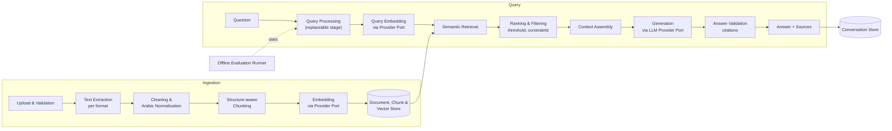

# Software Requirements Specification (SRS)
## Basic RAG AI System

| Item | Value |
|---|---|
| Document ID | SRS-001 |
| Version | 1.1 |
| Phase | Phase 1: Requirements Analysis |
| Status | **Approved with amendments** (D-016); amendments applied in this version |
| Date | 2026-11-13 |
| Sources | `docs/PROJECT_BRIEF.md` (BR), `docs/DECISIONS.md` (D-xxx), `CLAUDE.md`, `docs/EXECUTION_PROTOCOL.md` |

**Change log**

| Version | Change |
|---|---|
| 0.1 | Initial draft. |
| 1.1 | NFR-LNG-02 redefined (D-029, P-011). |
| 1.0 | Owner amendments: Windows target (D-017); 10 MB file limit and latency approach (D-018); document version management (D-019, new §4.11); automatic conversation titles (D-020); use-case specialization through a domain profile (D-021, new §4.12). Numeric and quality targets approved as initial targets. |

---

## 1. Introduction

### 1.1 Purpose
This document specifies the functional and non-functional requirements of the Basic RAG AI System. It is the single source of truth for what the system must do. Later phases trace back to it: technology selection, design, implementation, testing, and evaluation.

### 1.2 Scope
The system is a standalone web application for a **single user on their own machine**. The user builds a private knowledge base from **Arabic** documents (**text-based PDF and Markdown**) and asks questions in Arabic. The system answers using **only** the content of those documents, shows the supporting sources, and states clearly when the knowledge base does not contain enough information.

The initial deployment is **specialized for one use case**: a help assistant answering questions from the official documentation of a fictional cloud platform for managing medical clinics (D-021). Domain specifics live in a configurable domain profile; the core pipeline stays domain-agnostic.

Language models and embedding models are consumed through the **free tiers of hosted providers** via API. Providers are switchable through configuration (D-010). The design must allow a local provider to be added later (D-013).

### 1.3 Definitions

| Term | Definition |
|---|---|
| **Document** | A logical knowledge source owned by the user. It has one or more versions (D-019). |
| **Document version** | One uploaded file (PDF or Markdown) of a document, with its metadata, chunks, and vectors. Exactly one version per document is **active**. |
| **Active version** | The only version of a document whose chunks are retrievable. |
| **Domain profile** | Configuration that specializes the system for a use case: assistant name, scope statement, intended users, UI welcome text, example questions (D-021). |
| **Chunk** | A contiguous segment of a document's extracted text. It is the unit of embedding, retrieval, and citation. |
| **Embedding** | A fixed-length numeric vector that represents a text's meaning, produced by an embedding model. |
| **Knowledge base (KB)** | The active versions of all documents that are in the **Ready** state, with their chunks and embeddings. |
| **Retrieval score** | The similarity score between the query embedding and a chunk embedding. Its scale depends on the model, and it is **not** a probability. |
| **Relevance threshold** | The minimum retrieval score for a chunk to count as evidence (see §4.7). |
| **Context** | The ordered set of retrieved chunks sent to the LLM for one question. |
| **Citation** | A reference in an answer to a specific chunk in the context, by its identifier. |
| **Valid citation** | A citation whose identifier matches a chunk that was actually part of the context for that request. |
| **Insufficient-information response** | A standardized response stating that the KB does not contain enough information to answer (§4.7). |
| **Provider** | An external service that exposes an LLM or an embedding model through an API. |
| **Golden set** | A curated set of Arabic questions with reference answers and supporting locations, used for evaluation (Phase 2). |
| **LLM-as-judge** | Using an LLM to grade answers during offline evaluation only, never per request (D-007). |

### 1.4 Requirement conventions
- **IDs:** `FR-<AREA>-<NN>` for functional requirements and `NFR-<AREA>-<NN>` for non-functional ones. IDs never change. A removed requirement is marked *Withdrawn* and its ID is not reused.
- **Priority (MoSCoW):**
  - **M** (Must): required for acceptance.
  - **S** (Should): expected unless a documented reason prevents it.
  - **C** (Could): optional and only with approval.
- **Verification method:**
  - **T** (Test): an automated test.
  - **E** (Evaluation): measured on the golden set.
  - **I** (Inspection): review of code or documents.
  - **D** (Demonstration): a manual walkthrough.
- **Source:** where the requirement comes from, as a brief section (`BR §x`) or a decision (`D-xxx`). "Derived" means it is engineering-derived from a source, with rationale.

---

## 2. Overall Description

### 2.1 Product perspective
A self-contained application with a web user interface and a backend. It depends on two kinds of external services: an LLM provider and an embedding provider. Both are reached over HTTPS through free-tier APIs. Everything else (files, metadata, vectors, conversations) is stored locally on the user's machine.

### 2.2 User
There is one user (D-009). They have no special technical role, read and write Arabic, and run the application on their own machine. There are no accounts, logins, or roles.

### 2.3 Operating environment
- The owner's personal computer running **Windows** (D-017). Code should stay cross-platform where this costs nothing, but Windows is the acceptance platform.
- A modern desktop web browser.
- Outbound internet access to the selected model providers.
- No GPU is required, and no models are downloaded (D-013).

### 2.4 Constraints
| ID | Constraint | Source |
|---|---|---|
| CON-01 | Only text-based PDF and Markdown files are supported. | D-003 |
| CON-02 | Knowledge content, questions, and answers are in Arabic. | D-002 |
| CON-03 | LLM and embeddings come from hosted free-tier APIs only; no paid services. | D-010 |
| CON-04 | Single user, no authentication. The server is accessible from the local machine only. | D-009 |
| CON-05 | No model runs locally in this release. | D-013 |
| CON-06 | Code and technical documentation are in English. The UI is in Arabic with right-to-left layout. | D-008, D-012 |
| CON-07 | Secrets are never stored in code or in Git. | CLAUDE.md §5, §12 |
| CON-08 | No agents, multi-agent systems, orchestration frameworks, or workflow automation. | CLAUDE.md §7 |
| CON-09 | Windows is the target operating system for installation and acceptance. | D-017 |
| CON-10 | The assistant answers about the platform's documentation only. It gives no clinical or medical advice. | D-021 |

### 2.5 Assumptions and dependencies
| ID | Assumption | Impact if false |
|---|---|---|
| AS-01 | At least one hosted provider offers a free tier with acceptable Arabic quality for embeddings, and at least one for generation. | Phase 3 cannot meet CON-03. Escalate to the owner. |
| AS-02 | Free-tier rate limits allow ingesting the sample corpus and running the golden-set evaluation within reasonable time (minutes to hours, not days). | Evaluation design must batch and throttle. Escalate if infeasible. |
| AS-03 | The user accepts that document chunks and questions are sent to the selected providers. | Privacy constraint (NFR-PRV-01) must be revisited. |
| AS-04 | Uploaded PDFs contain an extractable text layer. | Out of scope: such files are rejected with a clear message (FR-ING-05). |
| AS-05 | Markdown files are UTF-8 encoded. | Rejected with a clear message (FR-DOC-03). |

---

## 3. Logical Architecture (technology-agnostic)

This view names the **responsibilities** the system needs, without choosing technologies (adjustment T2). Phase 3 selects technologies against these responsibilities, and Phase 4 turns them into a concrete design.

| Component | Responsibility | Pipeline stages (CLAUDE.md §6) |
|---|---|---|
| Upload & Validation | Accept files and validate type, size, integrity, and duplicates | 1 |
| Text Extraction | Produce text plus structure (pages, headings) from PDF or Markdown | 2 |
| Cleaning & Normalization | Fix extraction artifacts and apply documented Arabic normalization | 3 |
| Chunking | Split text into chunks that respect structure, with source metadata | 4 |
| Embedding Provider Port | A provider-agnostic interface for embedding text | 5 |
| Document/Chunk/Vector Store | Persist documents, chunks, vectors, and metadata consistently, and support similarity search | 6 |
| Query Processing | Validate and normalize the question. Kept replaceable for future query rewriting (D-011). | 7 |
| Semantic Retrieval | Find the top candidate chunks by vector similarity | 8 |
| Ranking & Filtering | Order candidates and apply the threshold, Ready-only, and size constraints | 9 |
| Context Assembly | Select and order chunks within the context budget, with citation IDs | 10 |
| LLM Provider Port | A provider-agnostic interface for generation | 11 |
| Answer Validation | Validate citations, detect insufficient-information signals, attach sources | 12 |
| Conversation Store | Persist conversations and messages in order | (BR §4.5) |
| Evaluation Runner | Offline measurement of retrieval and answer quality | (BR §9) |

---

## 4. Functional Requirements

### 4.1 Document management (FR-DOC)

| ID | Requirement | P | Verify | Source |
|---|---|---|---|---|
| FR-DOC-01 | The user shall be able to upload one or more files from the UI. | M | T, D | BR §4.1 |
| FR-DOC-02 | The system shall accept only PDF and Markdown (`.md`, `.markdown`) files. The type is determined from the file **content** (e.g., PDF signature; valid UTF-8 text for Markdown), not only from the extension. | M | T | D-003, BR §3.1.2 |
| FR-DOC-03 | The system shall reject, with a specific Arabic error message: unsupported types, files over the maximum size (NFR-PRF-04), empty files, corrupted or encrypted PDFs, and Markdown that is not valid UTF-8. | M | T | BR §3.1.2 |
| FR-DOC-04 | The system shall reject a file whose content (hash) is identical to **any existing version of any document**, and shall reference that document and version in the message. | M | T | D-019 |
| FR-DOC-05 | The system shall show a list of all documents with name, format, size, upload time, processing status, active version number, and number of versions. | M | T, D | BR §4.1, D-019 |
| FR-DOC-06 | The system shall show a document's details: the metadata of FR-DOC-05 plus page count (PDF), chunk count, processing timestamps, the embedding model used, the error message if processing failed, and the version history (FR-VER-03). | M | T, D | BR §4.1, D-019 |
| FR-DOC-07 | The user shall be able to delete a document. Deletion shall remove **all its versions**: stored files, extracted text, chunks, vectors, and metadata. It shall leave **no orphaned data** in any store, including after a failure partway through deletion. | M | T | BR §4.1, D-019 |
| FR-DOC-08 | Deleting a document that is still being processed shall not leave orphaned data. Whether deletion cancels processing or is refused until processing ends is decided in Phase 4. | M | T | Derived from FR-DOC-07 |
| FR-DOC-09 | The system shall keep the original uploaded file of every version until that version is deleted, so it can be reprocessed (e.g., after a change to chunking or embedding settings, or on restore). | M | T | Derived, D-019 |
| FR-DOC-10 | Uploading a file as a **new document** (rather than as a new version, FR-VER-01) shall always create a separate document, even if the file name matches an existing one. Documents shall be distinguishable in the UI (e.g., by upload time). | S | T | Derived |

### 4.2 Document processing / ingestion (FR-ING)

> Processing happens per **document version**. In this section, "document" means the version being processed.

| ID | Requirement | P | Verify | Source |
|---|---|---|---|---|
| FR-ING-01 | Processing shall run in the background. Uploading shall return immediately, and the UI shall remain usable, including chat. | M | T, D | BR §3.1.9, NFR-PRF-03 |
| FR-ING-02 | Each document shall follow an explicit lifecycle: `Uploaded → Processing → Ready` or `→ Failed`. The current stage shall be visible to the user while processing (e.g., extracting, chunking, embedding). | M | T | BR §3.1.9 |
| FR-ING-03 | On failure, the document shall be set to `Failed` with a user-readable Arabic message and a detailed technical log entry. A failed document shall not contribute any chunk to retrieval. | M | T | BR §3.1.9, §4.1 |
| FR-ING-04 | Text extraction from PDFs shall yield Arabic text in correct logical order. Presentation-form characters (e.g., U+FB50–U+FEFF) shall be mapped to standard Arabic letters, and lam-alef ligatures shall be decomposed correctly. | M | T, E | D-002, BR §4.2 |
| FR-ING-05 | A PDF with no extractable text layer (e.g., scanned) shall be detected and set to `Failed` with a message explaining that scanned PDFs are not supported. | M | T | D-003 |
| FR-ING-06 | Markdown extraction shall preserve the heading hierarchy and the text of lists and tables. Image references shall be ignored. Link text shall be kept. | M | T | D-003 |
| FR-ING-07 | Cleaning shall remove extraction artifacts: repeated page headers and footers where detectable, broken line-wrapping, and redundant whitespace and control characters. | M | T | BR §3.1.4 |
| FR-ING-08 | Arabic normalization rules (e.g., tatweel removal, diacritics handling, alef and yaa variants, Arabic-Indic vs. Western digits) shall be explicitly defined and documented. Their effect on retrieval shall be **measured**, not assumed. The **original text** shall be kept for display and citation. | M | I, E | D-002, BR §4.2 |
| FR-ING-09 | Chunking shall respect document structure: it shall prefer heading and paragraph boundaries and shall not split a table row or list item in the middle where avoidable. Chunk size and overlap shall be configurable. | M | T | BR §3.1.5 |
| FR-ING-10 | Each chunk shall record: document ID, sequence number, original text, page number(s) for PDFs, the heading path (section titles) where available, and character offsets. | M | T | BR §4.2 |
| FR-ING-11 | Embeddings shall be generated in batches through the embedding provider port. Rate-limit and transient errors shall be retried with backoff up to a configured limit; when the limit is exceeded, the document fails per FR-ING-03. | M | T | D-010 |
| FR-ING-12 | Each stored vector shall record the embedding model identifier and its dimension. | M | T | D-010 |
| FR-ING-13 | A version becomes `Ready` only when all of its chunks and vectors are stored. Partial results shall never be retrievable. | M | T | Derived (consistency) |
| FR-ING-14 | On application start, documents left in `Processing` by an interrupted run shall be detected and either resumed or set to `Failed` with a clear message. They shall not stay stuck. | M | T | NFR-REL-03 |

### 4.3 Retrieval (FR-RET)

| ID | Requirement | P | Verify | Source |
|---|---|---|---|---|
| FR-RET-01 | The system shall accept a natural-language question in Arabic. It shall reject empty questions and questions longer than the maximum length (NFR-PRF-06) with a clear message. | M | T | BR §3.2.1 |
| FR-RET-02 | The question shall pass through a **query-processing stage** that is a separate, replaceable component. In this release it applies validation and the same normalization used at indexing, and does not use earlier turns (D-011). | M | T, I | BR §3.2.2, D-011 |
| FR-RET-03 | The question shall be embedded with the **same embedding model** as the indexed chunks. If the configured model differs from the stored vectors' model, retrieval shall refuse to run and report that re-indexing is required. | M | T | D-010 |
| FR-RET-04 | The system shall retrieve the top-K most similar chunks (K configurable) from the **active, `Ready`** version of each document only. | M | T | BR §3.2.4, D-019 |
| FR-RET-05 | Results shall be ordered by relevance. Whether additional ranking (e.g., re-ranking or hybrid lexical search) is added shall be decided in Phase 8 **based on measured improvement** on the golden set. | M | E | BR §3.2.5 |
| FR-RET-06 | Chunks scoring below the relevance threshold shall be discarded. The threshold is configurable and is **calibrated empirically** on the golden set, including unanswerable questions. | M | T, E | D-007, BR §3.4 |
| FR-RET-07 | Context assembly shall select chunks within a configurable context budget (e.g., tokens or characters). It shall remove duplicate or overlapping text and give each chunk a stable citation identifier. | M | T | BR §3.2.7 |
| FR-RET-08 | If the KB is empty, or no chunk passes the threshold, the system shall return the insufficient-information response **without calling the LLM**. | M | T | BR §3.4, D-007 |

### 4.4 Generation (FR-GEN)

| ID | Requirement | P | Verify | Source |
|---|---|---|---|---|
| FR-GEN-01 | The prompt shall instruct the model to: answer in Arabic, use **only** the provided context, cite the chunk identifiers supporting each statement, and give a defined insufficient-information signal when the context does not answer the question. | M | I, E | BR §3.3.2, §3.4 |
| FR-GEN-02 | The prompt shall separate system instructions from document content, and shall present document content as data to be quoted, not as instructions to follow (prompt-injection mitigation). | M | I, T | NFR-SEC-03 |
| FR-GEN-03 | Prompt templates shall be versioned, and the prompt version used shall be recorded with each answer. | S | I | Derived (evaluation reproducibility) |
| FR-GEN-04 | Generation shall go through the LLM provider port. The provider, model, endpoint, and parameters are set in configuration. | M | T | D-010, D-013 |
| FR-GEN-05 | Provider errors (timeout, rate limit, unavailable, invalid key) shall be handled with bounded retries where appropriate, and then reported to the user with a specific Arabic message. The application shall not crash. | M | T | NFR-REL-04 |
| FR-GEN-06 | Where the answer contains a statement the sources do not support, the model shall be instructed to state explicitly that the information was not found in the sources, rather than present it as fact. | M | E | BR §3.4 |

### 4.5 Answer validation and source attribution (FR-VAL)

| ID | Requirement | P | Verify | Source |
|---|---|---|---|---|
| FR-VAL-01 | After generation, every citation in the answer shall be checked against the identifiers of the chunks in that request's context. | M | T | D-007 |
| FR-VAL-02 | Invalid citations shall be removed from the displayed answer. If the answer is not an insufficient-information response but **no valid citation remains**, it shall be shown with a visible "not verified against sources" warning. | M | T | D-007 |
| FR-VAL-03 | If the model returns the insufficient-information signal, the system shall show the standardized insufficient-information response. Retrieved chunks shall **not** be presented as supporting sources in that case. | M | T | BR §3.4 |
| FR-VAL-04 | For each answer, the system shall show the cited sources: document name, version number, page (PDF) or section heading, and the cited chunk text (fully or expandable). | M | T, D | BR §3.3.6, §4.4, D-019 |
| FR-VAL-05 | Each answer shall be recorded with an outcome: `answered`, `answered_unverified`, `insufficient_information`, or `error`. | M | T | Derived (evaluation, history) |

### 4.6 Conversations and history (FR-CONV)

| ID | Requirement | P | Verify | Source |
|---|---|---|---|---|
| FR-CONV-01 | The user shall be able to start a new conversation. | M | T, D | BR §4.5 |
| FR-CONV-02 | Each question and answer shall be stored in order within its conversation. The stored data includes the question, answer, outcome, citations (with a **snapshot** of the cited text and source name), timestamps, and the configuration used (models, prompt version). | M | T | BR §4.5, D-011 |
| FR-CONV-03 | The user shall see a list of previous conversations (most recent first) and be able to reopen one, with full content and sources. | M | T, D | BR §4.5 |
| FR-CONV-04 | Each question shall be processed independently: earlier turns shall not be sent to retrieval or to the LLM (D-011). | M | T | D-011 |
| FR-CONV-05 | If a cited document or version is later deleted or replaced, past answers shall remain readable from the snapshot. The source shall be marked as deleted or as no longer the active version. | M | T | Derived (FR-DOC-07, D-019) |
| FR-CONV-06 | Each conversation shall get an automatic title derived from its first question (truncated to a readable length). | S | T | D-020 |

### 4.7 Insufficient-information behaviour (consolidated)

This section consolidates BR §3.4 into testable rules:

1. **No evidence:** the KB is empty, or no chunk passes the threshold. The system returns the standardized insufficient-information response and makes no LLM call (FR-RET-08).
2. **Evidence present but not answering:** the LLM returns the insufficient-information signal. The system shows the standardized response and presents no sources as evidence (FR-VAL-03).
3. **Partial answer:** the LLM answers the supported part with citations and states explicitly which part is not covered (FR-GEN-06).
4. **Unverifiable answer:** no valid citation remains. The answer is shown with a warning (FR-VAL-02).

Cases 1–3 are measured on the golden set (refusal accuracy, NFR-QLT-03). Case 4's frequency is reported in the evaluation.

### 4.8 Configuration and providers (FR-CFG)

| ID | Requirement | P | Verify | Source |
|---|---|---|---|---|
| FR-CFG-01 | The LLM provider and the embedding provider shall be selected independently through configuration, with no code change to the RAG pipeline. | M | T | D-010 |
| FR-CFG-02 | Provider configuration shall be expressed as endpoint, model name, optional API key, and parameters. An API key shall **not** be mandatory at the abstraction level (local-provider readiness, D-013). | M | I, T | D-013 |
| FR-CFG-03 | Secrets shall come from environment variables. A template file without real values shall be provided. | M | I | CON-07 |
| FR-CFG-04 | On start-up the system shall validate its configuration and fail fast with a clear message for missing or invalid values (e.g., a missing key for a provider that needs one). | M | T | NFR-REL-04 |
| FR-CFG-05 | A documented **re-index** operation shall re-embed all document versions that hold vectors with the currently configured embedding model. It shall not mix vectors from different models during the transition. | M | T | D-010, D-019 |
| FR-CFG-06 | RAG parameters (chunk size and overlap, top-K, threshold, context budget, retry limits) shall be configurable without code changes. | M | I | Derived (evaluation and tuning) |

### 4.9 User interface (FR-UI)

| ID | Requirement | P | Verify | Source |
|---|---|---|---|---|
| FR-UI-01 | The UI shall be in Arabic with a right-to-left layout, and shall render mixed Arabic and Latin text (file names, numbers) correctly. | M | D | D-012 |
| FR-UI-02 | A **documents** view shall provide upload (new document or new version), list, details with version history, status, error display, version activation, and delete with confirmation. | M | D | BR §4.1, D-019 |
| FR-UI-03 | Processing status shall update in the UI without manual page reload. | S | D | BR §4.1 |
| FR-UI-04 | A **chat** view shall provide question input, answer display, sources (FR-VAL-04), and clear loading and error states. | M | D | BR §4.5 |
| FR-UI-05 | A conversation list shall allow starting a new conversation and reopening previous ones. | M | D | BR §4.5 |
| FR-UI-06 | The UI shall distinguish visually between: a verified answer, an unverified answer (warning), an insufficient-information response, and an error. | M | D | BR §3.4, FR-VAL-05 |
| FR-UI-07 | When the KB is empty, the chat view shall tell the user to upload documents first. | S | D | Derived (usability) |
| FR-UI-08 | The chat view shall show the domain profile's assistant name, welcome text, and example questions. | M | D | D-021 |

### 4.10 Evaluation (FR-EVAL)

| ID | Requirement | P | Verify | Source |
|---|---|---|---|---|
| FR-EVAL-01 | An offline evaluation runner shall run the golden set through the real retrieval and generation pipeline. | M | D | BR §9, CLAUDE.md §5 |
| FR-EVAL-02 | Retrieval metrics: Hit@K, Recall@K, and MRR against the golden set's annotated supporting locations. | M | E | BR §9 |
| FR-EVAL-03 | Answer metrics: refusal accuracy on unanswerable questions, false-refusal rate on answerable ones, citation-validity rate, and LLM-as-judge scores for faithfulness and correctness. | M | E | BR §9, D-007 |
| FR-EVAL-04 | LLM-as-judge shall be used **only** in the evaluation runner. The judge model shall be configurable and should differ from the generation model, to reduce self-preference bias. | M | I | D-007 |
| FR-EVAL-05 | Each evaluation run shall produce a stored report recording the configuration (models, prompt version, parameters) and the corpus/golden-set version, so results are reproducible and comparable. | M | I | BR §9 |
| FR-EVAL-06 | The evaluation shall respect provider rate limits (throttling and resumability), so a run can complete within free-tier limits. | S | D | D-010, AS-02 |

### 4.11 Document version management (FR-VER)

| ID | Requirement | P | Verify | Source |
|---|---|---|---|---|
| FR-VER-01 | The user shall be able to upload a file as a **new version of an existing document**. The new version gets the next version number. Format may differ between versions (PDF or Markdown). | M | T, D | D-019 |
| FR-VER-02 | Exactly one version per document shall be active. A newly uploaded version becomes active **only when it reaches `Ready`**. Until then, the previous active version stays retrievable. If the new version fails, the previous one stays active. | M | T | D-019 |
| FR-VER-03 | The user shall be able to view a document's version history: version number, file name, format, size, upload time, status, and which version is active. | M | T, D | D-019 |
| FR-VER-04 | The user shall be able to activate (restore) any earlier version that can become `Ready`. The switch shall be atomic: no retrieval may see chunks from two versions of the same document, or a document with no retrievable version, during the switch. | M | T | D-019 |
| FR-VER-05 | The user shall be able to delete an individual non-active version. The active version cannot be deleted on its own; the user activates another version first or deletes the whole document (FR-DOC-07). | M | T | D-019 |
| FR-VER-06 | Version history is linear: no branching, merging, or content diffing between versions. | M | I | D-019 (scope bound) |
| FR-VER-07 | Phase 4 decides, with justification, whether inactive versions keep their chunks and vectors (instant restore, more storage) or have them removed and regenerated on restore (less storage, uses provider quota). Either way, inactive chunks are never retrievable and FR-DOC-09 holds. | M | I | D-019, D-010 |

### 4.12 Use-case specialization (FR-DOM)

| ID | Requirement | P | Verify | Source |
|---|---|---|---|---|
| FR-DOM-01 | The system shall be specialized for a use case through a **domain profile** held in configuration: assistant name, scope statement (used in the system prompt), intended users, UI welcome text, and example questions. | M | I, T | D-021 |
| FR-DOM-02 | Ingestion, retrieval, generation, and validation shall contain **no domain-specific logic**. Re-targeting the system to another domain requires only a new domain profile and corpus, with no code change. | M | I | D-021 |
| FR-DOM-03 | The initial domain profile targets a **help assistant for a fictional cloud clinic-management platform**. Its intended users are the clinic administrators and staff who use the platform, and it answers from the platform's official documentation. | M | I | D-021 |
| FR-DOM-04 | The scope statement shall instruct the assistant to answer only about the platform's documentation and to give no clinical or medical advice. Out-of-scope questions follow the insufficient-information rules (§4.7). | M | E | D-021, CON-10 |

---

## 5. Non-Functional Requirements

> Numeric targets marked **(initial)** were approved by the owner as initial targets (D-018). They are re-baselined after the first measurement, and changes require owner approval. They assume normal provider availability. Time spent waiting on provider rate limits is reported separately, because it is outside the system's control.

### 5.1 Language (NFR-LNG)
| ID | Requirement | P | Verify |
|---|---|---|---|
| NFR-LNG-01 | All user-facing text (UI, messages, errors, answers) is in Arabic. | M | D |
| NFR-LNG-02 | On every sample PDF, after extraction and cleaning: (a) the order-insensitive letter error is ≤ 1%, and (b) 100% of golden-set evidence passages remain intact. Letter CER is reported for information only. *(Revised in v1.1, D-029: the former "CER ≤ 2%" target conflated letter correctness with table reading order; see TECH-001 §7.1.)* | M | T |

### 5.2 Performance (NFR-PRF)
| ID | Requirement | P | Verify |
|---|---|---|---|
| NFR-PRF-01 | Answer latency shall be acceptable for interactive use and shall be improvable. **(initial)** Target: median ≤ 10 s and 95th percentile ≤ 20 s on the sample corpus. A baseline is measured in Phase 9; improvements are proposed from the measurements. | S | T |
| NFR-PRF-02 | **(initial)** Retrieval (excluding provider calls) ≤ 1 s for a KB of up to 20,000 chunks. | S | T |
| NFR-PRF-03 | Ingestion never blocks the UI or chat. | M | T |
| NFR-PRF-04 | Maximum upload size of **10 MB** per file (D-018). | M | T |
| NFR-PRF-05 | **(initial)** Supported KB capacity: at least 100 documents and 20,000 chunks. | S | T |
| NFR-PRF-06 | **(initial)** Maximum question length of 1,000 characters. | M | T |

### 5.3 Reliability (NFR-REL)
| ID | Requirement | P | Verify |
|---|---|---|---|
| NFR-REL-01 | A failure while processing one document does not affect other documents. | M | T |
| NFR-REL-02 | Document, chunk, and vector data stay consistent: no orphaned or partial data after deletion, failure, or crash. | M | T |
| NFR-REL-03 | The system recovers from interrupted processing on restart (FR-ING-14). | M | T |
| NFR-REL-04 | Provider and configuration errors produce clear messages and never crash the application. | M | T |

### 5.4 Security and privacy (NFR-SEC / NFR-PRV)
| ID | Requirement | P | Verify |
|---|---|---|---|
| NFR-SEC-01 | The server listens on the local loopback interface only by default. | M | T, I |
| NFR-SEC-02 | Uploaded files are stored under system-generated names, never user-supplied paths (prevents path traversal). Size and type are checked before full processing. | M | T |
| NFR-SEC-03 | Document content is treated as data. A test document containing embedded instructions shall not change system behaviour (prompt-injection test). | M | T, E |
| NFR-SEC-04 | No secrets in code, logs, or Git. Logs do not contain API keys. | M | I |
| NFR-PRV-01 | The documentation states which data is sent to which provider (chunks, questions), and records each selected provider's free-tier data-usage terms. | M | I |
| NFR-PRV-02 | Logs at the default level do not contain full document text or full answers. | S | I |

### 5.5 Maintainability and testability (NFR-MNT)
| ID | Requirement | P | Verify |
|---|---|---|---|
| NFR-MNT-01 | Each logical component (§3) has a single clear responsibility and a defined interface. | M | I |
| NFR-MNT-02 | Automated tests do not call real providers; they use test doubles. Real-provider integration tests are separate and opt-in. | M | I |
| NFR-MNT-03 | Every Must requirement is traceable to at least one test or evaluation (traceability matrix, §8). | M | I |
| NFR-MNT-04 | Code style and formatting are enforced by automated tooling. | S | I |
| NFR-MNT-05 | Structured logs with a per-request and per-document correlation identifier. | S | I |

### 5.6 Extensibility (NFR-EXT)
| ID | Requirement | P | Verify |
|---|---|---|---|
| NFR-EXT-01 | Follow-up question support can be added by replacing the query-processing stage, without changes to retrieval, generation, or storage (D-011). | M | I |
| NFR-EXT-02 | A local model provider can be added as a new provider implementation plus configuration, without changing pipeline logic (D-013). | M | I |
| NFR-EXT-03 | Extensibility is achieved with minimal interfaces only. No unused machinery is shipped (CLAUDE.md §5). | M | I |

### 5.7 Portability and operability (NFR-OPS)
| ID | Requirement | P | Verify |
|---|---|---|---|
| NFR-OPS-01 | The application installs and runs on the owner's **Windows** machine from a clean environment by following the README only. | M | D |
| NFR-OPS-04 | Automated tests run on Windows as well as on the development platform, so platform-specific defects (paths, encodings, file locking) are caught before acceptance. | S | T |
| NFR-OPS-02 | Dependencies are pinned (lockfile) for reproducible installs. | M | I |
| NFR-OPS-03 | All persistent data lives in one configurable data directory, so it is easy to back up or reset. | S | I |

### 5.8 Cost (NFR-CST)
| ID | Requirement | P | Verify |
|---|---|---|---|
| NFR-CST-01 | Operation requires no paid service (D-010). | M | I |
| NFR-CST-02 | The free-tier limits of each selected provider, and their effect on ingestion and evaluation, are documented. | M | I |

### 5.9 Answer quality targets (NFR-QLT)
> These are **initial targets approved by the owner** (D-018), measured on the golden set. They are re-baselined in Phase 8 and Phase 9; any change requires owner approval. They are not pass/fail gates for software tests (CLAUDE.md §5: test success is distinct from quality).

| ID | Metric | Initial target |
|---|---|---|
| NFR-QLT-01 | Retrieval Hit@5 (answerable questions) | ≥ 0.85 |
| NFR-QLT-02 | Retrieval MRR (answerable questions) | ≥ 0.70 |
| NFR-QLT-03 | Refusal accuracy (unanswerable questions correctly answered with insufficient information) | ≥ 0.80 |
| NFR-QLT-04 | False-refusal rate (answerable questions wrongly refused) | ≤ 0.15 |
| NFR-QLT-05 | Faithfulness (LLM-as-judge: answer supported by cited chunks) | ≥ 0.90 |
| NFR-QLT-06 | Correctness (LLM-as-judge against the reference answer) | ≥ 0.80 |
| NFR-QLT-07 | Citation validity after validation (structural, FR-VAL-01) | 100% |

---

## 6. Use Cases

**Actors:** User (primary); LLM provider and embedding provider (secondary, external).

### UC-01 Upload a document
- **Precondition:** The application is running.
- **Main flow:**
  1. The user selects one or more files.
  2. The system validates each file (FR-DOC-02/03/04).
  3. The system stores the file and creates a document record in the `Uploaded` state.
  4. The system starts background processing (UC-02).
  5. The UI shows the document with its status.
- **Alternatives:**
  - 2a. The file is invalid → a specific error is shown and nothing is stored.
  - 2b. The file is a duplicate → the user is told which document already holds it.
- **Postcondition:** The document exists and is being processed.

### UC-02 Process a document (system)
- **Main flow:**
  1. Extract the text.
  2. Clean and normalize it.
  3. Chunk it.
  4. Embed the chunks in batches.
  5. Store everything.
  6. Set the document to `Ready`.
- **Alternatives:**
  - No text layer → `Failed` (FR-ING-05).
  - Provider error beyond retries → `Failed` (FR-ING-11).
  - Crash → recovered on restart (FR-ING-14).
- **Postcondition:** `Ready` with all chunks retrievable, or `Failed` with no retrievable chunks.

### UC-03 View documents and details
The user opens the documents view, sees the list (FR-DOC-05), and opens a document's details (FR-DOC-06).

### UC-04 Delete a document
- **Main flow:**
  1. The user requests deletion.
  2. The system asks for confirmation.
  3. The system removes all related data (FR-DOC-07).
  4. The list updates.
- **Alternative:** The document is being processed → handled per FR-DOC-08.
- **Postcondition:** No trace of the document in any store. Past answers remain readable (FR-CONV-05).

### UC-05 Ask a question
- **Precondition:** A conversation is open (created automatically if none).
- **Main flow:**
  1. The user submits an Arabic question.
  2. The system validates and processes it (FR-RET-01/02).
  3. The system retrieves, filters, and assembles context.
  4. The system generates an answer.
  5. The system validates the citations.
  6. The system shows the answer with its sources.
  7. The system stores the exchange.
- **Alternatives:**
  - 3a. The KB is empty or no chunk passes the threshold → insufficient-information response.
  - 4a. The model signals insufficient information → standardized response.
  - 4b. Provider error → error message, stored with the `error` outcome.
  - 5a. No valid citations → answer shown with a warning.
- **Postcondition:** The exchange is persisted with its outcome.

### UC-06 Browse and reopen conversations
The user opens the conversation list, selects a conversation, and sees its full history with sources (FR-CONV-03).

### UC-07 Start a new conversation
The user starts a new, empty conversation (FR-CONV-01).

### UC-08 Change provider or model (operator)
- **Main flow:**
  1. The user edits the configuration.
  2. The user restarts the application.
  3. The system validates the configuration (FR-CFG-04).
- **Alternative:** The embedding model changed → retrieval is blocked until re-index (FR-RET-03), and the user runs the re-index operation (FR-CFG-05).

### UC-10 Upload a new version of a document
- **Main flow:**
  1. The user opens a document.
  2. The user chooses "upload new version" and selects a file.
  3. The system validates the file (FR-DOC-02/03/04).
  4. The system processes the new version in the background (UC-02).
  5. When the new version is `Ready`, it becomes active (FR-VER-02).
- **Alternatives:**
  - 3a. The content is identical to an existing version → rejected with a reference to that version.
  - 4a. Processing fails → the previous version stays active, and the failed version is shown in the history with its error.

### UC-11 View version history and restore a version
- **Main flow:**
  1. The user opens a document's version history (FR-VER-03).
  2. The user activates an earlier version (FR-VER-04).
  3. Retrieval switches to that version atomically.
- **Alternative:** The user deletes a non-active version (FR-VER-05).

### UC-09 Run evaluation (developer)
- **Main flow:**
  1. The developer runs the evaluation runner on the golden set.
  2. The runner throttles to respect rate limits.
  3. It writes a report with metrics and the configuration snapshot (FR-EVAL-01..06).

---

## 7. Data Requirements (logical)

| Entity | Key attributes | Notes |
|---|---|---|
| Document | id, display name, active version id, created time | Logical source with one or more versions |
| Document version | id, document id, version number, original file name, format, size, content hash, upload time, status, stage, error message, page count, chunk count, embedding model id, processing timestamps | One per uploaded file |
| Chunk | id, document version id, sequence, original text, normalized text (if different), pages, heading path, char offsets, size | Deleted with its version |
| Vector | chunk id, embedding model id, dimension, vector | Exactly one per chunk per active model |
| Conversation | id, title, created and updated times | Single user, so no owner field |
| Message | id, conversation id, sequence, question, answer, outcome, prompt version, model ids, timestamps | Ordered within the conversation |
| Citation | message id, chunk id (nullable after deletion), document name snapshot, version number snapshot, location snapshot, cited text snapshot | Keeps history readable after deletion or version change |
| Evaluation run | id, time, configuration snapshot, corpus and golden-set version, metrics, per-question results | Stored as report files or records (decided in Phase 4) |

**Retention:** Data is kept until the user deletes it. No automatic expiry.

---

## 8. Traceability Matrix (requirements ← sources)

The design and test columns are filled in Phases 4 and 5–11.

| Source | Requirements |
|---|---|
| BR §3.1 Ingestion pipeline | FR-DOC-01..04, FR-ING-01..14 |
| BR §3.2 Retrieval pipeline | FR-RET-01..08 |
| BR §3.3 Generation pipeline | FR-GEN-01..06, FR-VAL-01..05 |
| BR §3.4 Insufficient information | FR-RET-06, FR-RET-08, FR-GEN-06, FR-VAL-02, FR-VAL-03, §4.7, NFR-QLT-03/04 |
| BR §4.1 Knowledge-source management | FR-DOC-01..10, FR-UI-02/03 |
| BR §4.2 Document processing | FR-ING-04..13 |
| BR §4.3 Semantic search | FR-RET-01..07 |
| BR §4.4 Answer generation | FR-GEN-01..06, FR-VAL-04 |
| BR §4.5 Chat interface | FR-CONV-01..06, FR-UI-04..07 |
| BR §5 Sample corpus and golden set | Phase 2 deliverables, FR-EVAL-01..06 |
| BR §6.1 / D-002 Arabic | FR-ING-04, FR-ING-08, NFR-LNG-01/02, FR-UI-01 |
| BR §6.4 / D-010 / D-013 Providers | FR-CFG-01..06, FR-ING-11/12, FR-RET-03, FR-GEN-04, NFR-EXT-02 |
| BR §6.6 Security and privacy | NFR-SEC-01..04, NFR-PRV-01/02, FR-GEN-02 |
| BR §6.9 / D-011 Follow-up readiness | FR-RET-02, FR-CONV-02/04, NFR-EXT-01 |
| BR §9 / D-007 Verification and evaluation | FR-VAL-01..05, FR-EVAL-01..06, NFR-QLT-01..07 |
| D-003 Formats | FR-DOC-02/03, FR-ING-04..06 |
| D-009 Single user | CON-04, NFR-SEC-01 |
| D-012 Arabic RTL UI | FR-UI-01 |
| D-017 Windows target | CON-09, NFR-OPS-01, NFR-OPS-04 |
| D-018 File size and latency | NFR-PRF-01, NFR-PRF-04 |
| D-019 Version management | FR-VER-01..07, FR-DOC-04..10, FR-RET-04, FR-VAL-04, FR-CONV-05, FR-CFG-05 |
| D-020 Conversation titles | FR-CONV-06 |
| D-021 Use-case specialization | FR-DOM-01..04, FR-UI-08, CON-10 |

---

## 9. Out of Scope (this release)

- Multiple users, authentication, roles, or permissions (D-009).
- Formats other than text-based PDF and Markdown; OCR (D-003).
- Running models locally (D-013). The design is prepared for it.
- Follow-up questions that depend on conversation context (D-011). The design is prepared for it.
- Paid services, cloud deployment, or network exposure.
- Agents, multi-agent systems, orchestration, workflow automation (CLAUDE.md §7).
- Editing documents in the app, and multiple knowledge bases.
- Version branching, merging, or diffing (FR-VER-06).
- Clinical or medical advice (CON-10).
- Streaming token-by-token responses. A loading state is sufficient (it may be proposed later as a separate change).
- Deleting conversations and exporting answers (not required by the brief; may be proposed later).

---

## 10. Open Items

All Phase 1 open items are resolved: P-004 → D-017, P-005 → D-018, P-007 → D-019, OI-01 → D-020. The corpus topic (P-006) is resolved by D-021 and is detailed in Phase 2.
