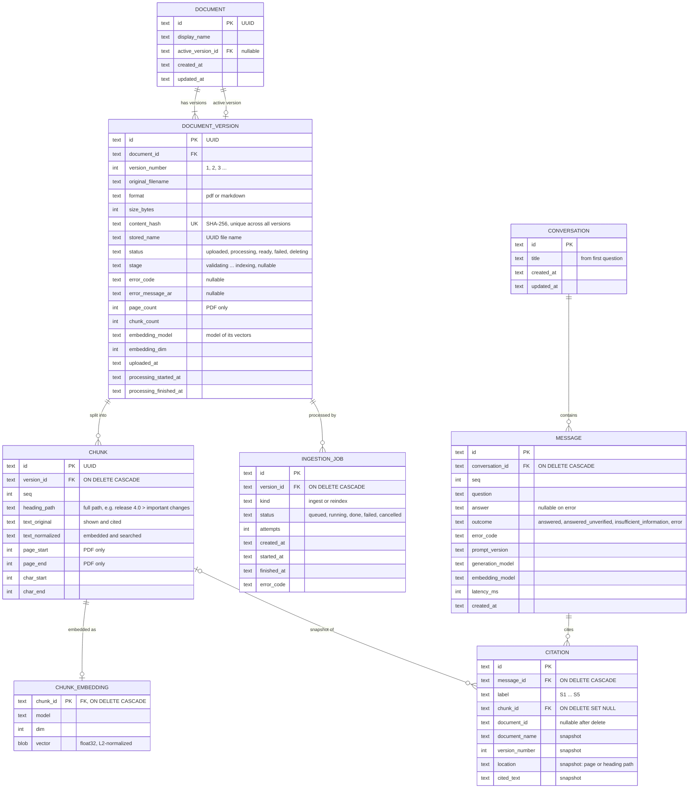
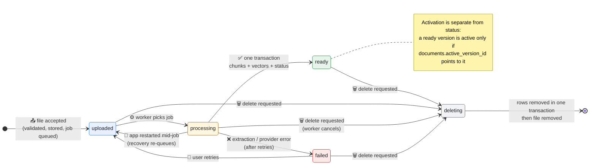

# Architecture and Technical Design

| Item | Value |
|---|---|
| Document ID | DESIGN-001 |
| Phase | Phase 4: Architecture and Technical Design |
| Status | **Draft for owner review** |
| Date | 2026-11-13 |
| Inputs | SRS-001 v1.1 (`docs/01_SRS.md`), TECH-001 (`docs/03_TECHNOLOGY_EVALUATION.md`), CORPUS-001, `docs/DECISIONS.md` |
| Approved stack | Python + FastAPI · Jinja2 + HTMX · SQLite + NumPy · pdftotext · gemini-embedding-001 · qwen3.8-27b (Groq) · OpenAI-compatible adapters (D-027 to D-029) |

> **How to read the diagrams.** Every diagram uses the same shapes, icons, and colours. The diagrams are Mermaid and render directly on GitHub.

| Shape / colour | Meaning |
|---|---|
| 👤 🖥️ Blue, rounded | People and the user interface |
| ⚙️ Green, rectangle | Application services (our code) |
| 🔶 Amber, hexagon | Pipeline stages (one RAG step each) |
| 🗄️ Purple, cylinder | Persistent data |
| ☁️ Red, asymmetric | External providers (over the internet) |
| 🔧 Grey, subroutine | Local external tool (Poppler) |

---

## 1. Design Goals and Principles

| Goal | Design consequence | Source |
|---|---|---|
| Every RAG stage is visible and testable | One module per stage, each with a small explicit interface; no framework orchestration | CLAUDE.md §6, T-14 |
| Data is never half-written | **The database is the single source of truth.** A version's chunks and vectors are written in **one transaction** together with its `ready` status and activation | FR-DOC-07, FR-ING-13, FR-VER-04 |
| Providers are replaceable | The pipeline depends on **ports** (interfaces), not on providers. OpenAI-compatible adapters are selected by configuration | D-010, D-013, T-13 |
| Simple to run on Windows | One process, one SQLite file, one data folder; only external tool is Poppler | D-017, D-028, NFR-OPS |
| Honest answers | Layered verification: relevance gate → model refusal signal → citation validation | D-007, BR §3.4 |
| Domain-agnostic core | All domain wording lives in the **domain profile** (configuration) | FR-DOM-01..04 |
| No unused machinery | Extension points exist only where a requirement names them (query processing, providers) | NFR-EXT-03 |

---

## 2. System Context


**Boundaries:**
- Everything inside the owner's Windows machine runs in **one Python process**, bound to `127.0.0.1` (NFR-SEC-01).
- The only data leaving the machine is:
  - chunk texts sent to the embedding provider (at ingestion);
  - questions sent to the embedding provider (at query time);
  - question plus retrieved passages sent to the LLM provider;
  - during offline evaluation only, question, answers, and passages sent to the judge provider (NFR-PRV-01).

---

## 3. Component Architecture

The code is organised in four layers. Dependencies point **downwards only**; the pipeline never imports a provider adapter or SQL directly. The two pipelines are the twelve RAG stages of CLAUDE.md §6 (stage 6, storage, is the repositories).


Which component uses which port:

| Stage / service | Uses |
|---|---|
| 1 Validate · DocumentService | FileStore, Repositories |
| 2 Extract | PdfExtractor (PDF) or markdown-it-py (Markdown) |
| 5 Embed · 7 Process query | Embedding port |
| 8–9 Retrieve + rank | VectorIndex (which loads from Repositories) |
| 11 Generate | Chat port |
| IngestionWorker · ChatService | Repositories (all writes, in transactions) |

### 3.1 Responsibilities

| Component | Responsibility | Must not | Requirements |
|---|---|---|---|
| Web UI | Render Arabic RTL pages; HTMX partial updates (status polling, chat messages) | Contain business rules | FR-UI-01..08 |
| JSON API | Validate requests, call services, map errors to HTTP | Touch SQL or providers | FR-DOC, FR-CONV |
| CLI | Operator tasks: `check`, `reindex`, `evaluate` | Run while another CLI writes (single-writer lock) | FR-CFG-04/05, FR-EVAL |
| DocumentService | Upload (new document / new version), list, details, activate, delete; enqueue ingestion jobs | Call providers | FR-DOC, FR-VER |
| IngestionWorker | Run jobs: extract → clean → chunk → embed → **commit once**; recover interrupted jobs at start-up | Expose partial results | FR-ING-01..14 |
| ChatService | Run the query pipeline; persist messages and citation snapshots | Send earlier turns to retrieval/LLM (D-011) | FR-RET, FR-GEN, FR-VAL, FR-CONV |
| EvaluationRunner | Run the golden set through ChatService; compute metrics; call the judge | Run in the request path | FR-EVAL-01..06 |
| Pipeline stages | One RAG step each; pure functions where possible | Know about HTTP or SQL | SRS §3 |
| Repositories | All SQL; transactions; schema migrations | Contain RAG logic | NFR-REL-02 |
| VectorIndex | Exact cosine search over the **active** vectors; reload when the index generation changes | Return chunks of inactive / non-ready versions | FR-RET-04, T-05 |
| FileStore | Store originals under generated names in the data folder | Use user-supplied paths | NFR-SEC-02 |
| PdfExtractor | Run `pdfinfo`/`pdftotext` safely (argument list, timeout) | Use a shell | D-028 |
| EmbeddingProvider / ChatProvider ports | Provider-agnostic calls with retries/backoff and typed errors | Leak provider-specific types into the pipeline | D-010, D-013 |

---

## 4. Deployment View


- **SQLite in WAL mode** lets the web requests read while the worker writes. All writes go through one connection-per-thread with short transactions.
- One process means no inter-process coordination. The CLI uses a lock file in the data folder so `reindex` cannot run while the app is running (it refuses with a clear message).

---

## 5. Data Model (SQLite)

### 5.1 Entity-relationship diagram



Two small tables complete the schema:
- `meta`, a key-value table: `schema_version`, `index_embedding_model`, `index_embedding_dim`, `index_generation`.
- `schema_migrations`, which records the ordered SQL migration files that have been applied.

### 5.2 Key design choices

| Choice | Why | Requirement |
|---|---|---|
| `DOCUMENT` separate from `DOCUMENT_VERSION`, with `active_version_id` on the document | Activation is one `UPDATE`, so it is atomic. Retrieval joins on `active_version_id` and therefore can never see two versions of one document | FR-VER-02, FR-VER-04 |
| `content_hash` unique across **all** versions | Rejects identical content wherever it already exists, with a pointer to it | FR-DOC-04 |
| `text_original` and `text_normalized` both stored | Display and citation use the original text; search uses the normalized text | FR-ING-08 |
| `heading_path` holds the **full** path | Phase 3 finding (T-11, finding 6): a chunk must state which release or section it belongs to | FR-ING-10 |
| Vectors as float32 BLOBs, tagged with model and dim | No vectors from different models are ever mixed; re-indexing is detectable | FR-ING-12, FR-RET-03 |
| `CITATION` stores a **snapshot**, and its chunk link is `ON DELETE SET NULL` | Past answers stay readable after deletion or version change | FR-CONV-05 |
| `ON DELETE CASCADE` from version to chunks, embeddings, and jobs | Deleting a version cannot leave orphaned rows | FR-DOC-07 |
| `PRAGMA foreign_keys=ON`, `journal_mode=WAL` | Enforced integrity; readers do not block the worker | NFR-REL-02 |

### 5.3 Inactive versions keep their vectors (resolves FR-VER-07)

| Option | Restore speed | Provider quota | Storage |
|---|---|---|---|
| **Keep the chunks and vectors of inactive versions** | Instant (one `UPDATE`) | None | Measured scale: ~100 chunks × 3,072 × 4 bytes ≈ **1.2 MB per version** |
| Delete them, regenerate on restore | Minutes; can fail on quota | Uses the free-tier embedding quota, which hit per-minute limits in Phase 3 | Smaller |

**Proposal: keep them.** The storage cost is negligible for a single user, and the alternative spends the scarcest resource, free-tier quota, on every restore.

---

## 6. Document Version Lifecycle



| Rule | Detail | Requirement |
|---|---|---|
| A new version becomes active **only** when it reaches `ready` | The same transaction that sets `ready` also sets `documents.active_version_id` | FR-VER-02 |
| If a new version fails | The previous active version stays active; the failed version stays in the history with its error | FR-VER-02 |
| Restoring an older version | Allowed only for `ready` versions; one `UPDATE` plus `index_generation += 1` | FR-VER-04 |
| Deleting the active version alone | Refused with `409 VERSION_IS_ACTIVE`; activate another version or delete the document | FR-VER-05 |
| Deleting while processing (resolves FR-DOC-08) | **Cancel:** status is set to `deleting`. The worker checks the status between stages and before its final commit, then discards its in-memory results | FR-DOC-08 |
| Recovery at start-up | Jobs left `running` return to `queued` (attempt + 1, up to 3), and their versions go back to `uploaded`; after 3 attempts the version becomes `failed` with `INTERRUPTED` | FR-ING-14 |

---

## 7. Consistency Mechanisms

### 7.1 The "one commit" rule for ingestion
Extraction, cleaning, chunking, and embedding all happen **in memory**. The version's rows are written by one final transaction:

```text
BEGIN IMMEDIATE
  re-check version.status = 'processing'     -- cancelled? → ROLLBACK, discard
  INSERT chunks (all)
  INSERT chunk_embeddings (all)
  UPDATE document_versions SET status='ready', chunk_count, embedding_model, ...
  UPDATE documents SET active_version_id = :version_id
  UPDATE meta SET index_generation = index_generation + 1
COMMIT
```

A crash before `COMMIT` leaves **nothing** behind except the job, which recovery re-queues. Readers either see the whole version or none of it (FR-ING-13).

### 7.2 Deletion order: database first, then files
1. **One transaction** deletes the document (or version) rows. Cascades remove chunks, embeddings, and jobs, citations keep their snapshots, and `index_generation` is incremented.
2. **After the commit**, the original files are deleted.
3. If step 2 fails (e.g., a file is locked on Windows), the file is an orphan **with no database reference**. A sweep at start-up removes files in `uploads/` that no version references. The user never sees inconsistent data (FR-DOC-07, NFR-REL-02).

### 7.3 Vector index cache invalidation
`VectorIndex` holds the active vectors in a NumPy matrix (T-05). Before each search it reads `meta.index_generation`, a single-row read that costs microseconds. If the value changed since the matrix was loaded, the matrix is reloaded. Every transaction that changes the active set increments the counter: ready, activate, delete, and re-index. **No search can use a stale set of documents.**

### 7.4 Embedding model changes and re-indexing
- At start-up and before each search, the configured embedding model is compared with `meta.index_embedding_model`.
- **If they differ:** questions are refused with `REINDEX_REQUIRED` and an Arabic explanation (FR-RET-03). The documents page shows a banner.
- **`rag reindex` (CLI)** embeds every version that has chunks, inactive versions included (§5.3), into a staging table. A single transaction then swaps the vectors and updates `meta`. If it is interrupted, the old index stays intact (FR-CFG-05).
