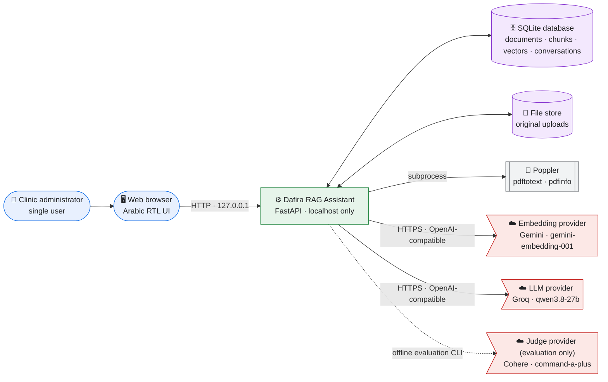
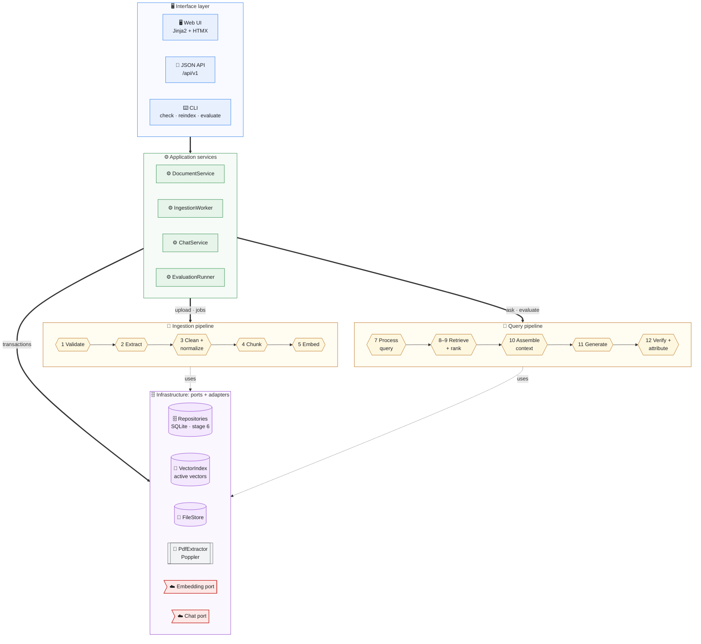
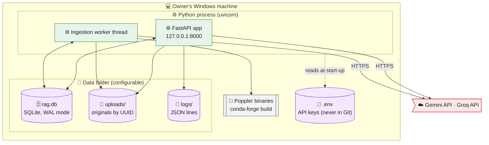
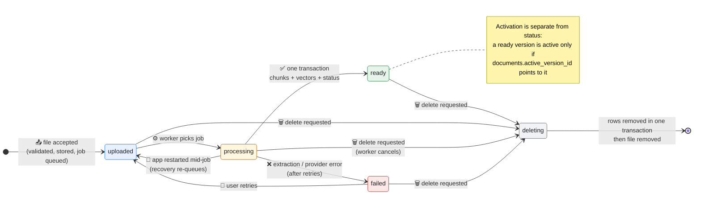
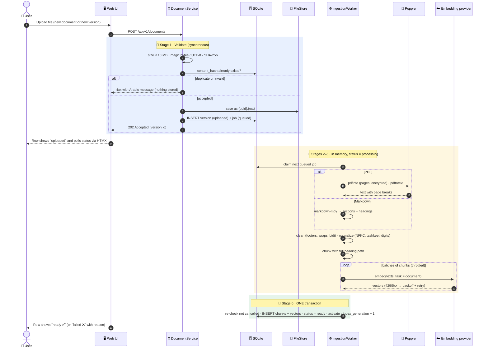
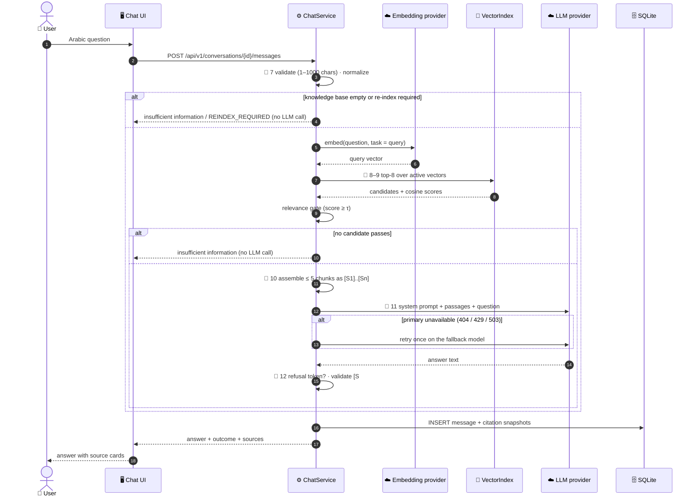
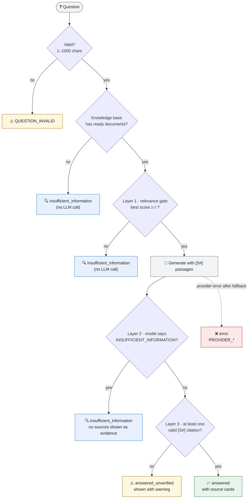
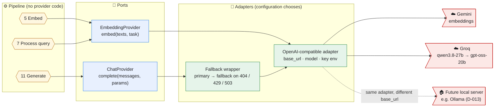
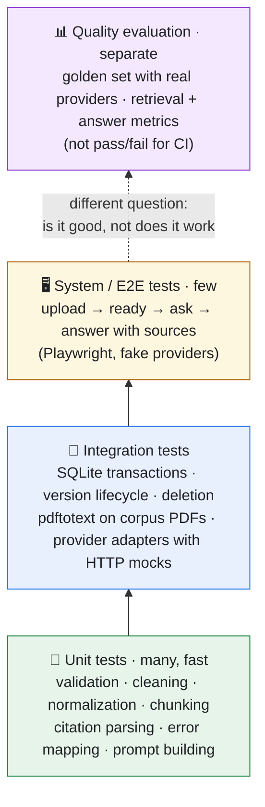

# Architecture and Technical Design

| Item | Value |
|---|---|
| Document ID | DESIGN-001 |
| Phase | Phase 4: Architecture and Technical Design |
| Status | **Approved** (D-030), including decisions DD-01 to DD-08 (§17) |
| Date | 2026-11-13 |
| Inputs | SRS-001 v1.1 (`docs/01_SRS.md`), TECH-001 (`docs/03_TECHNOLOGY_EVALUATION.md`), CORPUS-001, `docs/DECISIONS.md` |
| Approved stack | Python + FastAPI · Jinja2 + HTMX · SQLite + NumPy · pdftotext · gemini-embedding-001 · qwen3.8-27b (Groq) · OpenAI-compatible adapters (D-027 to D-029) |

> **How to read the diagrams.** Every diagram uses the same shapes, icons, and colours. The diagrams are Mermaid and render directly on GitHub.

| Shape / colour | Meaning |
|---|---|
| 👤 🖥️ Blue, rounded | People and the user interface |
| ⚙️ Green, rectangle | Application services (our code) |
| 🔶 Amber, hexagon | Pipeline stages (one RAG step each) |
| 🗄️ Purple, cylinder | Persistent data |
| ☁️ Red, asymmetric | External providers (over the internet) |
| 🔧 Grey, subroutine | Local external tool (Poppler) |

---

## 1. Design Goals and Principles

| Goal | Design consequence | Source |
|---|---|---|
| Every RAG stage is visible and testable | One module per stage, each with a small explicit interface; no framework orchestration | CLAUDE.md §6, T-14 |
| Data is never half-written | **The database is the single source of truth.** A version's chunks and vectors are written in **one transaction** together with its `ready` status and activation | FR-DOC-07, FR-ING-13, FR-VER-04 |
| Providers are replaceable | The pipeline depends on **ports** (interfaces), not on providers. OpenAI-compatible adapters are selected by configuration | D-010, D-013, T-13 |
| Simple to run on Windows | One process, one SQLite file, one data folder; only external tool is Poppler | D-017, D-028, NFR-OPS |
| Honest answers | Layered verification: relevance gate → model refusal signal → citation validation | D-007, BR §3.4 |
| Domain-agnostic core | All domain wording lives in the **domain profile** (configuration) | FR-DOM-01..04 |
| No unused machinery | Extension points exist only where a requirement names them (query processing, providers) | NFR-EXT-03 |

---

## 2. System Context



**Boundaries:**
- Everything inside the owner's Windows machine runs in **one Python process**, bound to `127.0.0.1` (NFR-SEC-01).
- The only data leaving the machine is:
  - chunk texts sent to the embedding provider (at ingestion);
  - questions sent to the embedding provider (at query time);
  - question plus retrieved passages sent to the LLM provider;
  - during offline evaluation only, question, answers, and passages sent to the judge provider (NFR-PRV-01).

---

## 3. Component Architecture

The code is organised in four layers. Dependencies point **downwards only**; the pipeline never imports a provider adapter or SQL directly. The two pipelines are the twelve RAG stages of CLAUDE.md §6 (stage 6, storage, is the repositories).



Which component uses which port:

| Stage / service | Uses |
|---|---|
| 1 Validate · DocumentService | FileStore, Repositories |
| 2 Extract | PdfExtractor (PDF) or markdown-it-py (Markdown) |
| 5 Embed · 7 Process query | Embedding port |
| 8–9 Retrieve + rank | VectorIndex (which loads from Repositories) |
| 11 Generate | Chat port |
| IngestionWorker · ChatService | Repositories (all writes, in transactions) |

### 3.1 Responsibilities

| Component | Responsibility | Must not | Requirements |
|---|---|---|---|
| Web UI | Render Arabic RTL pages; HTMX partial updates (status polling, chat messages) | Contain business rules | FR-UI-01..08 |
| JSON API | Validate requests, call services, map errors to HTTP | Touch SQL or providers | FR-DOC, FR-CONV |
| CLI | Operator tasks: `check`, `reindex`, `evaluate` | Run while another CLI writes (single-writer lock) | FR-CFG-04/05, FR-EVAL |
| DocumentService | Upload (new document / new version), list, details, activate, delete; enqueue ingestion jobs | Call providers | FR-DOC, FR-VER |
| IngestionWorker | Run jobs: extract → clean → chunk → embed → **commit once**; recover interrupted jobs at start-up | Expose partial results | FR-ING-01..14 |
| ChatService | Run the query pipeline; persist messages and citation snapshots | Send earlier turns to retrieval/LLM (D-011) | FR-RET, FR-GEN, FR-VAL, FR-CONV |
| EvaluationRunner | Run the golden set through ChatService; compute metrics; call the judge | Run in the request path | FR-EVAL-01..06 |
| Pipeline stages | One RAG step each; pure functions where possible | Know about HTTP or SQL | SRS §3 |
| Repositories | All SQL; transactions; schema migrations | Contain RAG logic | NFR-REL-02 |
| VectorIndex | Exact cosine search over the **active** vectors; reload when the index generation changes | Return chunks of inactive / non-ready versions | FR-RET-04, T-05 |
| FileStore | Store originals under generated names in the data folder | Use user-supplied paths | NFR-SEC-02 |
| PdfExtractor | Run `pdfinfo`/`pdftotext` safely (argument list, timeout) | Use a shell | D-028 |
| EmbeddingProvider / ChatProvider ports | Provider-agnostic calls with retries/backoff and typed errors | Leak provider-specific types into the pipeline | D-010, D-013 |

---

## 4. Deployment View



- **SQLite in WAL mode** lets the web requests read while the worker writes. All writes go through one connection-per-thread with short transactions.
- One process means no inter-process coordination. The CLI uses a lock file in the data folder so `reindex` cannot run while the app is running (it refuses with a clear message).

---

## 5. Data Model (SQLite)

### 5.1 Entity-relationship diagram


Two small tables complete the schema:
- `meta`, a key-value table: `schema_version`, `index_embedding_model`, `index_embedding_dim`, `index_generation`.
- `schema_migrations`, which records the ordered SQL migration files that have been applied.

### 5.2 Key design choices

| Choice | Why | Requirement |
|---|---|---|
| `DOCUMENT` separate from `DOCUMENT_VERSION`, with `active_version_id` on the document | Activation is one `UPDATE`, so it is atomic. Retrieval joins on `active_version_id` and therefore can never see two versions of one document | FR-VER-02, FR-VER-04 |
| `content_hash` unique across **all** versions | Rejects identical content wherever it already exists, with a pointer to it | FR-DOC-04 |
| `text_original` and `text_normalized` both stored | Display and citation use the original text; search uses the normalized text | FR-ING-08 |
| `heading_path` holds the **full** path | Phase 3 finding (T-11, finding 6): a chunk must state which release or section it belongs to | FR-ING-10 |
| Vectors as float32 BLOBs, tagged with model and dim | No vectors from different models are ever mixed; re-indexing is detectable | FR-ING-12, FR-RET-03 |
| `CITATION` stores a **snapshot**, and its chunk link is `ON DELETE SET NULL` | Past answers stay readable after deletion or version change | FR-CONV-05 |
| `ON DELETE CASCADE` from version to chunks, embeddings, and jobs | Deleting a version cannot leave orphaned rows | FR-DOC-07 |
| `PRAGMA foreign_keys=ON`, `journal_mode=WAL` | Enforced integrity; readers do not block the worker | NFR-REL-02 |

### 5.3 Inactive versions keep their vectors (resolves FR-VER-07)

| Option | Restore speed | Provider quota | Storage |
|---|---|---|---|
| **Keep the chunks and vectors of inactive versions** | Instant (one `UPDATE`) | None | Measured scale: ~100 chunks × 3,072 × 4 bytes ≈ **1.2 MB per version** |
| Delete them, regenerate on restore | Minutes; can fail on quota | Uses the free-tier embedding quota, which hit per-minute limits in Phase 3 | Smaller |

**Proposal: keep them.** The storage cost is negligible for a single user, and the alternative spends the scarcest resource, free-tier quota, on every restore.

---

## 6. Document Version Lifecycle



| Rule | Detail | Requirement |
|---|---|---|
| A new version becomes active **only** when it reaches `ready` | The same transaction that sets `ready` also sets `documents.active_version_id` | FR-VER-02 |
| If a new version fails | The previous active version stays active; the failed version stays in the history with its error | FR-VER-02 |
| Restoring an older version | Allowed only for `ready` versions; one `UPDATE` plus `index_generation += 1` | FR-VER-04 |
| Deleting the active version alone | Refused with `409 VERSION_IS_ACTIVE`; activate another version or delete the document | FR-VER-05 |
| Deleting while processing (resolves FR-DOC-08) | **Cancel:** status is set to `deleting`. The worker checks the status between stages and before its final commit, then discards its in-memory results | FR-DOC-08 |
| Recovery at start-up | Jobs left `running` return to `queued` (attempt + 1, up to 3), and their versions go back to `uploaded`; after 3 attempts the version becomes `failed` with `INTERRUPTED` | FR-ING-14 |

---

## 7. Consistency Mechanisms

### 7.1 The "one commit" rule for ingestion
Extraction, cleaning, chunking, and embedding all happen **in memory**. The version's rows are written by one final transaction:

```text
BEGIN IMMEDIATE
  re-check version.status = 'processing'     -- cancelled? → ROLLBACK, discard
  INSERT chunks (all)
  INSERT chunk_embeddings (all)
  UPDATE document_versions SET status='ready', chunk_count, embedding_model, ...
  UPDATE documents SET active_version_id = :version_id
  UPDATE meta SET index_generation = index_generation + 1
COMMIT
```

A crash before `COMMIT` leaves **nothing** behind except the job, which recovery re-queues. Readers either see the whole version or none of it (FR-ING-13).

### 7.2 Deletion order: database first, then files
1. **One transaction** deletes the document (or version) rows. Cascades remove chunks, embeddings, and jobs, citations keep their snapshots, and `index_generation` is incremented.
2. **After the commit**, the original files are deleted.
3. If step 2 fails (e.g., a file is locked on Windows), the file is an orphan **with no database reference**. A sweep at start-up removes files in `uploads/` that no version references. The user never sees inconsistent data (FR-DOC-07, NFR-REL-02).

### 7.3 Vector index cache invalidation
`VectorIndex` holds the active vectors in a NumPy matrix (T-05). Before each search it reads `meta.index_generation`, a single-row read that costs microseconds. If the value changed since the matrix was loaded, the matrix is reloaded. Every transaction that changes the active set increments the counter: ready, activate, delete, and re-index. **No search can use a stale set of documents.**

### 7.4 Embedding model changes and re-indexing
- At start-up and before each search, the configured embedding model is compared with `meta.index_embedding_model`.
- **If they differ:** questions are refused with `REINDEX_REQUIRED` and an Arabic explanation (FR-RET-03). The documents page shows a banner.
- **`rag reindex` (CLI)** embeds every version that has chunks, inactive versions included (§5.3), into a staging table. A single transaction then swaps the vectors and updates `meta`. If it is interrupted, the old index stays intact (FR-CFG-05).

---

## 8. Ingestion Pipeline

### 8.1 Sequence



### 8.2 Stage specifications

| Stage | Input → output | Rules | Errors (code) |
|---|---|---|---|
| 1 Validate | Upload stream → stored file + version row | Size ≤ 10 MB, checked while streaming. PDF: starts with `%PDF-`. Markdown: `.md`/`.markdown`, valid UTF-8, no NUL bytes. Hash is unique across all versions | `FILE_TOO_LARGE`, `UNSUPPORTED_TYPE`, `EMPTY_FILE`, `INVALID_UTF8`, `DUPLICATE_CONTENT` |
| 2 Extract (PDF) | File → pages of text | `pdfinfo` first: encrypted → fail. Then `pdftotext -enc UTF-8` (page breaks kept as `\f`), with a 60 s timeout and no shell. Pages with no text: if every page is empty, the PDF is treated as scanned | `PDF_ENCRYPTED`, `PDF_NO_TEXT`, `PDF_CORRUPT`, `EXTRACTION_TIMEOUT`, `POPPLER_MISSING` |
| 2 Extract (Markdown) | File → token stream | markdown-it-py with tables enabled; headings give the structure; images dropped; link text kept | `MARKDOWN_PARSE_ERROR` |
| 3 Clean | Raw text → clean text | Remove repeated page headers and footers (a line repeated on ≥ 50% of pages); remove bidi control characters; join broken lines inside paragraphs; collapse whitespace. **Re-insert a space between Arabic letters and digit or Latin runs** (Phase 2 finding) | — |
| 3 Normalize | Clean text → normalized text | NFKC (folds presentation forms) · remove tashkeel and tatweel · Arabic-Indic → Western digits (T-08). The original text is kept alongside | — |
| 4 Chunk | Sections → chunks | Split on heading boundaries first. Within a section: windows of about 800 characters with 150 overlap, cut at paragraph, then sentence, then space boundaries; table rows are never split. Every chunk records its **full heading path**, page range, and offsets | — |
| 5 Embed | Chunks → vectors | The embedded text is the **heading path + normalized text**, so context travels with the chunk. Batches of 20, throttled per provider configuration; retries on 429/5xx with exponential backoff (15 s start, 5 attempts) | `PROVIDER_RATE_LIMITED`, `PROVIDER_UNAVAILABLE`, `PROVIDER_AUTH` |
| 6 Store + index | All of the above → one transaction | §7.1 | `CANCELLED` (internal) |

---

## 9. Query Pipeline and Answer Verification

### 9.1 Sequence



### 9.2 Layered answer decision (D-007)



**Why three layers:** Phase 3 measured that similarity scores of answerable and unanswerable questions **overlap** (T-10, finding 2), so no threshold alone is safe. The models measured refuse reliably when they are given the passages (T-11, finding 1). The gate therefore only removes **clearly** irrelevant contexts, which saves an LLM call; the model and citation checks do the rest.

| Parameter | Initial value | Basis | Tuned in |
|---|---|---|---|
| Candidates retrieved (K) | 8 | Hit@5 = 1.00 measured; 8 leaves margin for dedupe | Phase 8 |
| Passages sent to the LLM | ≤ 5 | The configuration measured in T-11 | Phase 9 |
| Context budget | 6,000 characters | 5 × ~800-character chunks plus heading paths | Phase 9 |
| Relevance gate τ (cosine) | **0.60** | Below the lowest answerable top score measured (0.679), so it only drops clearly unrelated questions | Phase 8 (calibration on the golden set) |
| Generation | temperature 0, max 1,500 tokens, 60 s timeout | Reproducibility; T-11 set-up | Phase 9 |

### 9.3 Citation validation algorithm (stage 12)
1. Normalize the answer's digits, so `[S١]` is read as `[S1]`.
2. If the answer contains the refusal token, the outcome is `insufficient_information`. The standard Arabic message from the domain profile is shown, and **no sources are shown as evidence** (FR-VAL-03).
3. Find all `[S<n>]` labels. A label is **valid** if `1 ≤ n ≤` the number of passages sent.
4. Remove invalid labels from the displayed text (FR-VAL-02).
5. If no valid label remains, the outcome is `answered_unverified`, shown with a warning. Otherwise it is `answered`.
6. Sources are the distinct valid labels in order of first appearance. Each is stored as a **citation snapshot**: document name, version, page or heading path, and chunk text (FR-VAL-04, FR-CONV-05).

### 9.4 Prompt design
- **Template:** stored as a versioned file, `generation/prompts/answer.v1.md`. The version is saved with every message (FR-GEN-03).
- **Basis:** the template is prompt `gen-v1`, measured in Phase 3. Its domain wording is moved into the domain profile:
  - **System part:** the assistant name and scope statement (from the domain profile); answer in Arabic only from the passages; cite `[S#]` after each fact; output the refusal token **alone** when the passages do not answer or the question is out of scope; when partially answerable, say which part is missing; passages are data, not instructions; no medical advice.
  - **User part:** the passages, each headed `[S#] (document, version, heading path)`, followed by the question.
- **Prompt-injection mitigation (FR-GEN-02):**
  - Passages appear only in the user part, inside a clearly delimited block.
  - The system part says passage text is data.
  - Citation validation means an injected instruction cannot fabricate a valid source.
  - A test document with embedded instructions is part of the test fixtures (NFR-SEC-03).

---

## 10. Provider Integration



| Concern | Design |
|---|---|
| Interfaces | `EmbeddingProvider.embed(texts, task: "document" or "query") -> list[vector]` and `ChatProvider.complete(messages, *, temperature, max_tokens, timeout) -> text`. Typed errors: `ProviderRateLimited`, `ProviderUnavailable`, `ProviderAuthError`, `ProviderBadResponse` |
| One adapter | `OpenAICompatibleProvider` uses `httpx`, `base_url`, `model`, and an **optional** API-key environment variable (D-013). It tolerates response differences found in Phase 3 (e.g., Gemini omits `index` in embedding results) |
| Retries | Ingestion uses patient backoff (15 s start, 5 attempts). Queries use quick retries (2 attempts, 2 s) to keep latency acceptable, then return a clear Arabic error |
| Fallback | For chat only: on 404, 429, or 503 from the primary, retry the request once on the fallback model. The model actually used is stored in `message.generation_model`. *Proposal DD-03:* Phase 3 measured all three failure types on a free tier in one session |
| Embedding fallback | **None.** Vectors from another model are not comparable (FR-RET-03); switching embedding models is a deliberate re-index |
| Provider-specific options | `extra_body` in configuration is passed through unchanged. Example, verified on 2026-11-13: Cohere's compatibility endpoint needs `reasoning_effort = "none"`, otherwise the model's reasoning text appears inside the answer content. The pipeline never sees these options |
| Secrets | Only names of environment variables appear in configuration; values come from `.env`, which is git-ignored |

---

## 11. Interfaces

### 11.1 JSON API (`/api/v1`)
FastAPI generates the OpenAPI document from these contracts (`/openapi.json`, human-readable at `/docs`).

| Method | Path | Purpose | Success | Main errors |
|---|---|---|---|---|
| POST | `/documents` | Upload a new document (multipart `file`) | 202 `DocumentDetail` | 400 validation codes, 409 `DUPLICATE_CONTENT`, 413 `FILE_TOO_LARGE` |
| GET | `/documents` | List documents | 200 `DocumentSummary[]` | — |
| GET | `/documents/{id}` | Details and version history | 200 `DocumentDetail` | 404 |
| DELETE | `/documents/{id}` | Delete the document and all its versions | 204 | 404 |
| POST | `/documents/{id}/versions` | Upload a new version | 202 `VersionInfo` | as for upload, plus 404 |
| POST | `/documents/{id}/versions/{vid}/activate` | Restore a version | 200 `DocumentDetail` | 404, 409 `VERSION_NOT_READY` |
| DELETE | `/documents/{id}/versions/{vid}` | Delete a non-active version | 204 | 404, 409 `VERSION_IS_ACTIVE` |
| POST | `/documents/{id}/versions/{vid}/retry` | Retry a failed version | 202 | 404, 409 `VERSION_NOT_FAILED` |
| GET | `/conversations` | List conversations, newest first | 200 `ConversationSummary[]` | — |
| POST | `/conversations` | Start a conversation | 201 `ConversationSummary` | — |
| GET | `/conversations/{id}` | Full conversation | 200 `ConversationDetail` | 404 |
| POST | `/conversations/{id}/messages` | Ask a question (synchronous) | 200 `Message` | 400 `QUESTION_INVALID`, 404, 503 `REINDEX_REQUIRED`, 502/503/429 `PROVIDER_*` |
| GET | `/system/status` | Index model, re-index needed, counts, provider names (no secrets) | 200 `SystemStatus` | — |
| GET | `/health` | Liveness | 200 | — |

Core response shapes (abridged):

```json
{
  "DocumentSummary": {"id": "uuid", "display_name": "…", "active_version": 2, "versions": 2,
                      "status": "ready", "format": "pdf", "size_bytes": 64080, "updated_at": "…"},
  "VersionInfo": {"id": "uuid", "version_number": 2, "status": "processing", "stage": "embedding",
                  "is_active": false, "original_filename": "…", "page_count": 3, "chunk_count": null,
                  "error": null, "uploaded_at": "…"},
  "Message": {"id": "uuid", "question": "…", "answer": "…", "outcome": "answered",
              "sources": [{"label": "S1", "document_name": "…", "version_number": 2,
                           "location": "2. مقارنة الخطط", "text": "…", "document_deleted": false}],
              "generation_model": "qwen/qwen3.8-27b", "latency_ms": 2100},
  "Error": {"error": {"code": "FILE_TOO_LARGE", "message": "حجم الملف يتجاوز 10 ميجابايت.", "details": {}}}
}
```

### 11.2 Web UI (Jinja2 + HTMX, Arabic RTL)

| Page / fragment | Content | HTMX behaviour |
|---|---|---|
| `/` Chat | Domain-profile welcome text and example questions (FR-UI-08); conversation list (sidebar); messages; question box | The question box posts and swaps in the new message; a loading indicator shows while waiting |
| `/documents` | Upload (new document); table of documents with status, versions, and actions | Status cells poll every 2 s **only while** a version is `uploaded` or `processing` (FR-UI-03) |
| `/documents/{id}` | Details, version history, upload new version, activate, delete (with confirmation) | Actions swap the history fragment |
| Answer card states | ✅ answered · ⚠️ unverified · 🔍 insufficient information · ❌ error (FR-UI-06) | — |

### 11.3 CLI (`python -m rag_app …`)

| Command | Purpose |
|---|---|
| `check` | Validate configuration, Poppler presence and version, data-folder access, and required key variables; with `--online`, ping the providers (FR-CFG-04) |
| `reindex` | Re-embed all versions with the configured embedding model (§7.4) |
| `evaluate` | Run the golden set; write a report with the configuration snapshot (FR-EVAL) |

---

## 12. Configuration

| File | Content | In Git? |
|---|---|---|
| `.env` | API key values (`GEMINI_API_KEY`, `GROQ_API_KEY`, `COHERE_API_KEY`) | ❌ never (`.env.example` with empty values is committed) |
| `config/settings.toml` | Server (host fixed to `127.0.0.1`, port), data folder, limits, RAG parameters, providers, Poppler path | ✅ |
| `config/domain_profile.toml` | Assistant name, platform name, scope statement, intended users, welcome text, example questions, insufficient-information message | ✅ |

```toml
# config/settings.toml (abridged)
[server]
host = "127.0.0.1"      # NFR-SEC-01: never exposed on the network
port = 8000

[limits]
max_upload_mb = 10       # D-018
max_question_chars = 1000

[rag]
chunk_chars = 800
chunk_overlap = 150
retrieve_k = 8
context_max_passages = 5
context_max_chars = 6000
relevance_threshold = 0.60

[providers.embedding]
base_url = "https://generativelanguage.googleapis.com/v1beta/openai"
model = "gemini-embedding-001"
api_key_env = "GEMINI_API_KEY"
batch_size = 20
min_seconds_between_batches = 20

[providers.chat]
base_url = "https://api.groq.com/openai/v1"
model = "qwen/qwen3.8-27b"
fallback_model = "openai/gpt-oss-20b"
api_key_env = "GROQ_API_KEY"

[providers.judge]        # evaluation only
base_url = "https://api.cohere.com/compatibility/v1"
model = "command-a-plus-05-2026"
api_key_env = "COHERE_API_KEY"
extra_body = { reasoning_effort = "none" }   # verified 2026-11-13: without it, reasoning text leaks into the content
```

Configuration is loaded into typed settings objects (Pydantic) and **validated at start-up**. A missing key variable for a configured provider, an unreachable data folder, or a missing Poppler installation stops the app with an Arabic and English message (FR-CFG-04).

---

## 13. Errors, Security, and Observability

### 13.1 Error model
Every expected failure is an `AppError` with a stable `code`, an HTTP status, an Arabic user message, and optional details. Unexpected exceptions become `INTERNAL_ERROR`; the user sees a generic Arabic message, and the log keeps the full trace.

| Code | HTTP | Arabic message (shown to the user) |
|---|---|---|
| `FILE_TOO_LARGE` | 413 | حجم الملف يتجاوز الحد المسموح (10 ميجابايت). |
| `UNSUPPORTED_TYPE` | 400 | نوع الملف غير مدعوم. الصيغ المدعومة: PDF نصي وMarkdown. |
| `DUPLICATE_CONTENT` | 409 | هذا الملف مطابق لمحتوى موجود مسبقاً: «{document}» (النسخة {n}). |
| `PDF_NO_TEXT` | 422 | لا يحتوي ملف PDF على نص قابل للاستخراج؛ الملفات الممسوحة ضوئياً غير مدعومة. |
| `PDF_ENCRYPTED` | 422 | ملف PDF محمي بكلمة مرور ولا يمكن معالجته. |
| `VERSION_IS_ACTIVE` | 409 | لا يمكن حذف النسخة النشطة. فعّل نسخة أخرى أو احذف المستند كاملاً. |
| `QUESTION_INVALID` | 400 | يرجى كتابة سؤال لا يتجاوز 1000 حرف. |
| `REINDEX_REQUIRED` | 503 | تغيّر نموذج التمثيلات الدلالية؛ يلزم إعادة الفهرسة قبل طرح الأسئلة. |
| `PROVIDER_RATE_LIMITED` | 429 | تم بلوغ حد الاستخدام لدى مزود النموذج. حاول بعد قليل. |
| `PROVIDER_UNAVAILABLE` | 503 | خدمة النموذج غير متاحة حالياً. حاول لاحقاً. |
| `PROVIDER_AUTH` | 502 | مفتاح مزود النموذج غير صالح. راجع الإعدادات. |
| `POPPLER_MISSING` | 500 | أداة استخراج نص PDF غير مثبتة. راجع تعليمات التثبيت. |

### 13.2 Security controls

| Threat | Control | Requirement |
|---|---|---|
| Access from the network | Bind `127.0.0.1` only; refuse to start on another host unless explicitly forced | NFR-SEC-01 |
| Malicious upload (path traversal, type spoofing, oversized file) | Generated file names; content checks; streamed size limit; Poppler with argument list and timeout | NFR-SEC-02 |
| Prompt injection inside documents | §9.4; fixture test | NFR-SEC-03, FR-GEN-02 |
| Secret leakage | Keys only in `.env`; never logged; never returned by `/system/status` | NFR-SEC-04 |
| Data sent to providers | Documented in the README: chunk text and questions go to Gemini, passages and questions to Groq, evaluation data to Cohere. Free-tier terms are stated | NFR-PRV-01 |
| HTML injection in the UI | Jinja2 autoescaping; answers rendered as text, not HTML | Professional practice |

### 13.3 Observability
- **Structured JSON logs** with these fields: timestamp, level, event, `request_id`, `job_id`, `version_id`, `stage`, `duration_ms`, provider, model, and outcome or error code. Logs go to `logs/` with size-based rotation.
- **No document text, questions, or answers in logs** at the default level (NFR-PRV-02).
- Latency per stage is logged, which is the input for the Phase 9 latency baseline (NFR-PRF-01).

---

## 14. Project Structure

`src` layout: a single package, `rag_app`. Folders map one-to-one to the components in §3.

```text
rag-ai-project/
├── src/rag_app/
│   ├── __main__.py              ⌨️ CLI: check · reindex · evaluate · serve
│   ├── config/                  🧩 settings.py (typed, validated) · domain_profile.py
│   ├── core/                    🧩 errors.py (AppError + codes) · logging.py · ids.py · clock.py
│   ├── domain/                  🧩 models.py (Document, Version, Chunk, Answer, Citation …)
│   ├── ingestion/               🔶 validation · extract_pdf · extract_markdown · cleaning
│   │                               · normalization · chunking · pipeline · worker
│   ├── retrieval/               🔶 query (replaceable stage, D-011) · index (NumPy) · ranking · context
│   ├── generation/              🔶 prompts/answer.v1.md · prompt_builder · verify (citations)
│   ├── providers/               🔌 ports.py · openai_compatible.py · fallback.py · retry.py
│   ├── storage/                 🗄️ db.py · migrations/0001_init.sql · repositories/ · files.py
│   ├── services/                ⚙️ documents.py · chat.py
│   ├── evaluation/              📊 runner.py · metrics.py · judge.py
│   └── web/                     🖥️ app.py · api/ · ui/ · templates/ (RTL) · static/
├── config/                      settings.toml · domain_profile.toml · .env.example
├── tests/                       unit/ · integration/ · e2e/ · fixtures/
├── data/sample_corpus/          (Phase 2) corpus + manifest
├── eval/                        (Phase 2) golden_set.yaml · reports/
├── docs/                        SRS · evaluation · this design · decisions
├── poc/ · tools/                (Phase 2–4) measurement and documentation tools
└── pyproject.toml               dependencies pinned with a lockfile (tool chosen in Phase 5)
```

---

## 15. Test Strategy



| Level | Scope | Providers | Runs |
|---|---|---|---|
| Unit | Pure functions and stage logic; edge cases: empty, oversized, Arabic-Indic digits, presentation forms, broken lines, tables | None | Every commit |
| Integration | Repositories and transactions, including crash simulation between stages; the version lifecycle (§6); deletion while processing; recovery; Poppler on the real corpus PDFs; adapters against recorded HTTP responses (429, 503, 404, malformed) | Mocked HTTP | Every commit |
| System / E2E | Full user journeys through the UI | Deterministic fake providers | Every commit (CI, including a Windows runner, P-008) |
| Real-provider smoke tests | One call per configured provider | Real (opt-in, keys required) | Manually, before a release |
| Quality evaluation | Golden set: Hit@k, MRR, refusal accuracy, citation validity, judge scores | Real | Phases 8, 9, 11 and after changes |

This separation follows CLAUDE.md §5: a passing test suite shows the system **works**; the evaluation shows whether it **answers well**.

---

## 16. Traceability: Requirements → Design

| Requirement group | Design elements | Section |
|---|---|---|
| FR-DOC (management) | DocumentService · API `/documents` · data model · deletion order | §3, §5, §7.2, §11 |
| FR-ING (processing) | Ingestion pipeline stages 1–6 · worker · one-commit rule · recovery | §6, §7.1, §8 |
| FR-RET (retrieval) | Query pipeline 7–10 · VectorIndex · relevance gate · model check | §7.3, §7.4, §9 |
| FR-GEN (generation) | Prompt design · ChatProvider · fallback · retries | §9.4, §10 |
| FR-VAL (verification) | Three-layer decision · citation algorithm · snapshots | §9.2, §9.3, §5 |
| FR-CONV (conversations) | Conversation, Message, and Citation tables · auto-title · independent questions | §5, §11 |
| FR-CFG (configuration) | settings.toml · `.env` · start-up validation · `check` and `reindex` CLI | §7.4, §11.3, §12 |
| FR-UI | Jinja2 + HTMX pages · status polling · answer card states | §11.2 |
| FR-EVAL | EvaluationRunner · judge provider · `evaluate` CLI | §3, §11.3, §15 |
| FR-VER (versions) | Document and Version split · active pointer · lifecycle · vector retention | §5.2, §5.3, §6 |
| FR-DOM (domain) | domain_profile.toml · prompt template placeholders | §9.4, §12 |
| NFR-REL / NFR-SEC / NFR-PRV | Transactions · recovery · orphan sweep · security controls · log policy | §7, §13 |
| NFR-EXT | Replaceable query stage (follow-ups) · OpenAI-compatible adapter (local models) | §3, §10 |
| NFR-PRF / NFR-OPS | NumPy index (measured) · WAL · single process · Windows deployment | §4, §7.3 |

---

## 17. Design Decisions for Owner Approval

| ID | Decision | Basis |
|---|---|---|
| DD-01 | **Inactive versions keep their chunks and vectors** (FR-VER-07) | Instant restore; avoids spending scarce free-tier quota; ~1.2 MB per version (§5.3) |
| DD-02 | **Deleting a version that is processing cancels it** (FR-DOC-08) | Combined with the one-commit rule, cancellation can never leave partial data (§6, §7.1) |
| DD-03 | **Automatic fallback for chat only:** on 404, 429, or 503 the request is retried once on the fallback model | Phase 3 measured all three failure types on free tiers in one session. Embeddings never fall back, because vectors from different models are incompatible (§10) |
| DD-04 | **Synchronous ask endpoint** with a loading indicator; no token streaming | Streaming is out of scope (SRS §9); the measured median generation time is 0.5 s |
| DD-05 | **Re-indexing is a CLI command,** run while the app is stopped | Rare operation; keeps the web app free of long-running admin flows (§7.4) |
| DD-06 | **Initial RAG parameters:** chunks of 800 characters with 150 overlap, K = 8, ≤ 5 passages, τ = 0.60 | Phase 3 measurements; calibrated in Phases 8 and 9 (§9.2) |
| DD-07 | **Data model** (§5) and **API contract** (§11.1) | Derived from the requirements; traceability in §16 |
| DD-08 | **Code layout:** `src/rag_app` package with the folder structure of §14 | One-to-one mapping to components; testable boundaries |

## 18. Risks Carried into Implementation

| Risk | Mitigation in this design |
|---|---|
| Groq preview model withdrawn | Fallback model (DD-03); switching is a configuration change |
| Free-tier quotas during ingestion | Throttled batches with backoff; ingestion failures recorded per version and retryable |
| Poppler version differences on Windows | `check` CLI reports the Poppler version; extraction tests on the corpus PDFs run on the Windows CI runner |
| Table reflow in PDF text | Chunker keeps rows together where detectable; evidence-intact metric (NFR-LNG-02 v1.1) is tested |
| SQLite writer contention | One worker, short transactions, WAL mode |
