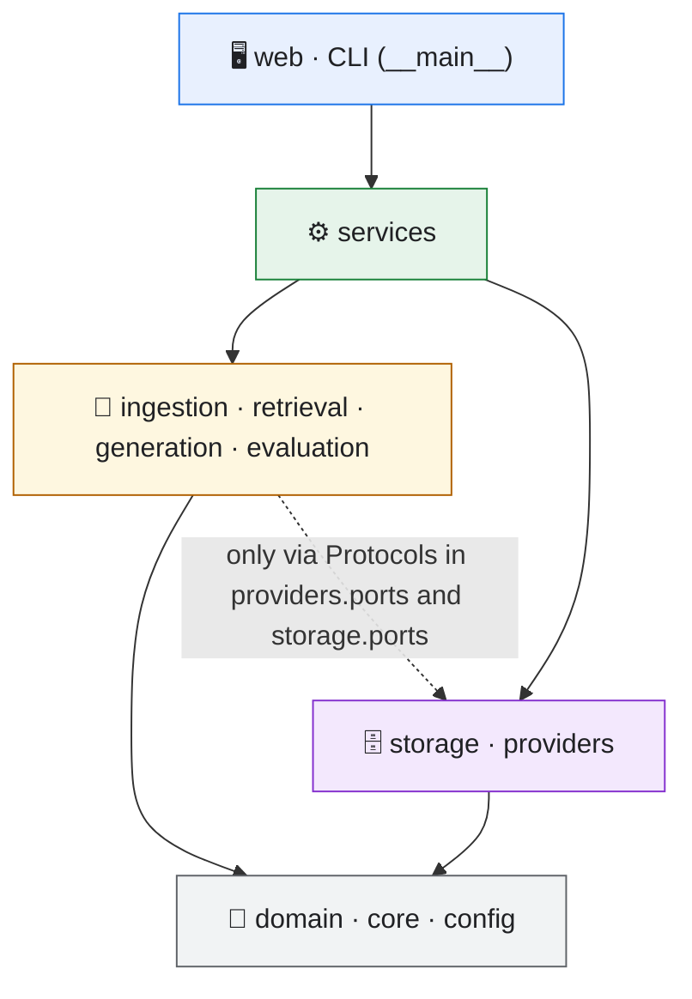
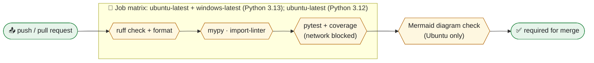

# Engineering Standards

| Item | Value |
|---|---|
| Document ID | STD-001 |
| Phase | Phase 5: Project Foundation and Environment (first deliverable, before any application code) |
| Status | **Draft for owner approval** |
| Date | 2026-11-14 |
| Applies to | All code, tests, configuration, and documentation in this repository |
| Builds on | `CLAUDE.md` §5 and §9–§13 · `docs/04_ARCHITECTURE_AND_DESIGN.md` (DESIGN-001) · `docs/DECISIONS.md` |

**Who this is for:** anyone who writes or reviews code in this project, including Claude and the owner.

**How to use it:** read §1 before writing anything; use the other sections as reference; run §13 before every commit.

**Keywords:** *MUST* means required, and CI enforces it where a tool can. *SHOULD* means expected; any deviation needs a stated reason in the code or the PR.

---

## 1. The Rules That Matter Most

1. **The layers of DESIGN-001 §3 are law.** The pipeline never imports SQL, HTTP, FastAPI, or a provider adapter. A tool enforces this (§4).
2. **Every function has type annotations,** and `mypy --strict` passes on `src/`.
3. **Every public module, class, and function has a docstring** saying *what* it does and *why*. Comments explain *why*, never *what*.
4. **Errors are typed (`AppError` with a code)** and translated to HTTP only in the web layer. There is no bare `except:`.
5. **Text files are always opened with `encoding="utf-8"`, and paths are always `pathlib.Path`.** Windows defaults differ from Linux.
6. **No secrets, document text, questions, or answers in logs, code, or Git.**
7. **SQL lives only in `storage/`, is always parameterised, and every multi-row write is one explicit transaction.**
8. **Tests never call real providers or the network.** The default test run blocks sockets.
9. **Behaviour and its documentation change in the same commit.**
10. **One logical change per commit,** with a Conventional Commits message. CI must be green on Linux **and** Windows before a PR is merged.

---

## 2. Toolchain

| Concern | Tool | Pinned in |
|---|---|---|
| Python version | **3.13** (`requires-python = ">=3.12,<3.14"`; CI also runs 3.12 on Linux) | `.python-version`, `pyproject.toml` |
| Dependencies, virtual environment, Python installation | **uv** (decision below) | `pyproject.toml`, `uv.lock` |
| Lint and format | **ruff** (`ruff check`, `ruff format`) | `pyproject.toml` |
| Type checking | **mypy**, strict on `src/` | `pyproject.toml` |
| Layer rules | **import-linter** | `pyproject.toml` |
| Tests | **pytest**, with pytest-cov, pytest-socket (blocks the network), and respx (HTTP mocks for httpx) | `pyproject.toml` |
| End-to-end UI tests (Phase 10) | Playwright for Python | `pyproject.toml` (optional group) |
| CI | GitHub Actions, on Ubuntu **and** Windows (D-031) | `.github/workflows/ci.yml` |

### 2.1 Decision: uv for dependency management
| Criterion | **uv** | Poetry 2 | pip-tools |
|---|---|---|---|
| Standard `pyproject.toml` (`[project]`, PEP 621) | ✅ | ✅ (since 2.0) | ✅ (input) |
| **One lockfile valid on Linux and Windows** (we develop on Linux; CI runs both; the target is Windows) | ✅ The lockfile is *universal*: resolved for all platforms and Python versions | ✅ Markers are locked (since 2.0) | ❌ Resolves for the current platform only, so a Linux-compiled file may not install on Windows |
| **Installs the required Python on a clean Windows machine** | ✅ Downloads managed Python automatically and registers it on Windows (PEP 514) | ⚠️ `poetry python install` is experimental (2.1) | ❌ |
| Single tool (environment, lockfile, running commands) | ✅ | ✅ | ❌ (pip, venv, and pip-tools together) |
| Already used in this project | ✅ (Phase 2–3 PoC environments) | — | — |

**Decision: uv.** Its universal lockfile removes a whole class of "works on Linux, fails on Windows" problems. Automatic Python installation makes a clean-machine setup a two-command affair:

```powershell
# Owner's Windows machine (PowerShell), after installing uv once
uv sync          # installs Python 3.13 if missing, creates .venv, installs exact locked versions
uv run rag check # validates configuration, Poppler, and keys
```

Sources: [uv resolution (universal lockfile)](https://docs.astral.sh/uv/concepts/resolution/) · [uv Python versions](https://docs.astral.sh/uv/concepts/python-versions/) · [Poetry 2.0 announcement](https://python-poetry.org/blog/announcing-poetry-2.0.0/) · [Poetry 2.1 announcement](https://python-poetry.org/blog/announcing-poetry-2.1.0/) · [pip-tools issue #414 (platform-specific hashes)](https://github.com/jazzband/pip-tools/issues/414)

### 2.2 Dependency rules
- Runtime dependencies MUST be justified by a requirement or decision. The PR that adds one names it. The initial set:
  - **FastAPI** with **uvicorn**: T-02.
  - **Jinja2**: D-027.
  - **Pydantic** and **pydantic-settings**: validation and settings.
  - **httpx**: T-13.
  - **NumPy**: T-05.
  - **markdown-it-py**: T-07.
  - **python-multipart**: uploads.
- Versions are locked by `uv.lock`, which is committed. `pyproject.toml` states compatible ranges, not exact pins.
- A new dependency SHOULD be at least two weeks old and actively maintained, and its licence MUST be compatible with the project (MIT, BSD, or Apache-2.0 preferred; no AGPL).

---

## 3. Repository Layout

The layout follows DESIGN-001 §14. Additions here: `tests/` mirrors `src/`, and tooling configuration lives in `pyproject.toml`.

```text
src/rag_app/<layer>/<module>.py       →  tests/unit/<layer>/test_<module>.py
                                      →  tests/integration/<area>/test_<scenario>.py
tests/e2e/test_<journey>.py           (Phase 10)
tests/fixtures/                       small, purpose-built files (e.g. prompt-injection.md, encrypted.pdf)
```

The sample corpus in `data/sample_corpus/` is read-only test input; tests never modify it.

---

## 4. Architecture and Import Rules



| Rule | Enforced by |
|---|---|
| Imports point **down** the diagram only. `domain`, `core`, and `config` import nothing from the project except each other | import-linter `layers` contract |
| `ingestion`, `retrieval`, `generation`, and `evaluation` MUST NOT import `storage` implementations, `providers` adapters, `httpx`, `sqlite3`, or `fastapi`. They depend on the `Protocol` classes in `providers/ports.py` and `storage/ports.py` | import-linter `forbidden` contracts |
| Only `web/` imports `fastapi` or `jinja2` | import-linter |
| Only `storage/` imports `sqlite3` | import-linter |
| Only `providers/` imports `httpx` | import-linter |
| Objects are wired together (dependency injection) in **one place**: `web/app.py` for the server and `__main__.py` for the CLI | Review |

**Why:** these rules make each RAG stage testable without a database or network (CLAUDE.md §6), and make a provider swap a configuration change (D-010).

---

## 5. Python Code Style

### 5.1 Formatting and naming
- `ruff format` decides formatting; nobody argues about it. Line length is 100.
- Names: `snake_case` for functions, variables, and modules; `PascalCase` for classes; `UPPER_SNAKE` for constants. Names say what a thing **is**, e.g. `active_version_id`, not `vid2`.
- Arabic text in code appears only in the **message catalogs** (`core/errors.py`, prompt templates, Jinja templates, the domain profile), never scattered in logic.

### 5.2 Structure
- **Pipeline stages are pure functions** where possible: input → output, no I/O. Example: `chunk(sections: Sequence[Section], cfg: ChunkingConfig) -> list[Chunk]`.
- A function SHOULD do one thing and fit on one screen (about 40 lines). A module SHOULD stay under about 400 lines; split it by responsibility, not alphabetically.
- **Domain models are frozen dataclasses** (`@dataclass(frozen=True, slots=True)`). **Pydantic is used only at boundaries:** API schemas and settings. Pydantic models never travel into the pipeline.
- **Prefer composition and small `Protocol` interfaces to inheritance.** No class hierarchy deeper than two levels.
- No global mutable state. Configuration is passed in, not imported from a global.
- No dead code, commented-out code, or `TODO` without an issue or phase reference.

### 5.3 Windows-safe practices (D-017)
| Rule | Why |
|---|---|
| `open(path, encoding="utf-8")` and `Path.read_text(encoding="utf-8")` always. Enforced by ruff rule `PLW1514`, a *preview* rule: it is enabled with `preview = true` plus `explicit-preview-rules = true`, so **only** explicitly selected preview rules turn on. Verified with ruff 0.17.5: it flags both `open()` and `Path.read_text()` without an encoding | Windows' default encoding is not UTF-8; Arabic text would break |
| `pathlib.Path` for all paths; no string concatenation with `/` or `\` | Different separators |
| Close files before deleting them (`with` blocks) | Windows locks open files (DESIGN-001 §7.2) |
| `subprocess.run([...], shell=False, timeout=...)` | No shell differences; no injection |
| `datetime.now(UTC)` and ISO-8601 strings in storage | No local-time ambiguity |
| `.gitattributes` fixes line endings (`* text=auto eol=lf`, with `*.ps1 eol=crlf`) | Same bytes on both systems; stable content hashes |

### 5.4 Example of the expected standard

```python
@dataclass(frozen=True, slots=True)
class Citation:
    """A source an answer relies on, frozen at answer time (FR-CONV-05)."""

    label: str
    chunk_id: str | None
    document_name: str
    version_number: int
    location: str
    text: str


def extract_citation_labels(answer: str, passage_count: int) -> tuple[list[int], str]:
    """Return the valid passage numbers cited in ``answer`` and the answer without invalid labels.

    A label is valid when it refers to a passage that was actually sent to the model
    (DESIGN-001 §9.3). Arabic-Indic digits are accepted because models sometimes emit them.

    Args:
        answer: Raw model output.
        passage_count: Number of passages sent, labelled S1..S<passage_count>.

    Returns:
        The valid passage numbers in order of first appearance (no duplicates),
        and the answer text with invalid labels removed.
    """
```

---

## 6. Typing
- `mypy --strict` on `src/`; tests are type-checked non-strictly.
- Ports are `typing.Protocol` classes. Adapters do not inherit from them; they only satisfy them.
- `Any` is allowed only at a boundary that parses untrusted JSON, and must have a comment. It is converted to typed objects immediately.
- Use `Literal` or `enum.StrEnum` for closed sets (version status, outcome, stage). Never use bare strings for these.

## 7. Errors
- One base class: `AppError(code: ErrorCode, *, details: dict[str, object] | None = None)`. The **Arabic message and HTTP status come from one catalog** keyed by `ErrorCode` (DESIGN-001 §13.1). Adding a code means adding a catalog entry and a test.
- Adapters convert third-party exceptions at the boundary. For example, `httpx.HTTPStatusError` 429 becomes `ProviderRateLimited`. Nothing above `providers/` sees `httpx` exceptions.
- No bare `except:` and no `except Exception` without re-raising or converting. Exceptions are never swallowed silently; if one is intentionally ignored, a comment says why and it is logged.
- The web layer maps `AppError` to the JSON error shape and HTTP status. Unexpected exceptions return `INTERNAL_ERROR` with a generic Arabic message; the log holds the trace.

## 8. Logging
- Standard library `logging` with a JSON formatter. A logger is created per module: `logger = logging.getLogger(__name__)`.
- Log **events**, not sentences: `logger.info("ingestion_stage_completed", extra={"version_id": vid, "stage": "chunk", "duration_ms": 41})`.
- Levels:
  - `DEBUG`: developer detail, off by default.
  - `INFO`: lifecycle events (upload, stage done, answer outcome).
  - `WARNING`: recoverable issues (retry, fallback used).
  - `ERROR`: a failed operation.
- **MUST NOT be logged:** API keys, document text, chunk text, questions, answers (NFR-PRV-02, NFR-SEC-04).
- Every request carries a `request_id` and every job a `job_id`; both appear in the related log lines.

## 9. Configuration and Secrets
- Settings are loaded once at start-up into typed objects and validated (DESIGN-001 §12). The app refuses to start on invalid settings, with a clear message.
- Secrets come only from environment variables or `.env`. `.env` is git-ignored; `.env.example` lists the names with empty values.
- Configuration files contain the **names** of key variables, never values.

## 10. Database
- SQL lives only in `storage/repositories/`. Queries always use `?` parameters, **never** string formatting.
- Every write that touches more than one row runs inside one explicit transaction (`with db.transaction():`). The one-commit rule of DESIGN-001 §7.1 is implemented exactly once and is tested.
- The schema changes only through numbered, forward-only SQL files in `storage/migrations/` (`0001_init.sql`, `0002_…`). A migration that has been applied is never edited.
- Required at connection time: `PRAGMA foreign_keys = ON` and `journal_mode = WAL`.

---

## 11. Testing Conventions

| Topic | Convention |
|---|---|
| Names | `test_<unit>_<behaviour>_<condition>`, e.g. `test_chunk_keeps_full_heading_path_for_nested_sections` |
| Shape | Arrange, Act, Assert, separated by blank lines. One behaviour per test |
| Markers | `unit`, `integration`, `e2e`, `provider` (real network, opt-in), `slow` |
| Default run | `uv run pytest` runs unit and integration tests, **with the network blocked** (pytest-socket). `-m provider` enables the real-provider smoke tests (keys required) |
| Test doubles | Fakes that implement the ports (`FakeEmbeddingProvider`, `FakeChatProvider`) are deterministic and live in `tests/fakes/`. HTTP-level tests use respx with recorded response shapes, including 429, 503, 404, and malformed bodies |
| Data | Small fixtures in `tests/fixtures/`; the corpus PDFs are used for extraction integration tests. Every database test uses a temporary database |
| Edge cases | Each stage tests: empty input, maximum size, Arabic-Indic digits, presentation forms, mixed Arabic and Latin text, and one failure path |
| Coverage | Measured in CI. **Target ≥ 85% line coverage** for `ingestion`, `retrieval`, `generation`, `storage`, and `services`. Coverage is a signal, not a goal: no tests written only to raise the number |
| Quality vs correctness | Golden-set metrics are **not** pass/fail tests. They run through `rag evaluate` and are reported separately (DESIGN-001 §15) |

---

## 12. Git, Commits, and Pull Requests
- **Branching:** work happens on the designated branch; there is one PR per approved phase (D-015). `main` only receives merged PRs.
- **Commits:** one logical change each, using **Conventional Commits**: `type(scope): summary`.
  - Types: `feat`, `fix`, `refactor`, `test`, `docs`, `build`, `ci`, `chore`, `perf`, `data`, `poc`.
  - Scopes: a layer or module name (`ingestion`, `storage`, `web`) or a phase (`phase-5`).
  - The summary is imperative and at most 72 characters. The body explains **why**, references requirement and decision IDs (`FR-ING-13`, `D-030`), and wraps at 72.
- **Commits MUST NOT contain** secrets, `.env` files, uploaded user data, generated databases or indexes, model weights, or large binaries (CLAUDE.md §11).
- **PR description:** summary, changes, verification evidence (commands and results), risks, and decisions referenced.
- **Merge condition:** CI green on **Ubuntu and Windows**, the review checklist (§13) satisfied, and owner approval of the phase.

---

## 13. Review Checklist (Definition of Done per change)

Run before every commit; it extends CLAUDE.md §13.

- [ ] `uv run ruff check` and `uv run ruff format --check` pass.
- [ ] `uv run mypy src` passes; `uv run lint-imports` passes (layer rules).
- [ ] `uv run pytest` passes; new behaviour has tests covering the normal case, an edge case, and a failure case.
- [ ] No secrets, content, or personal data in code, logs, fixtures, or commit messages.
- [ ] Errors use `AppError` codes with catalog messages; there are no silent `except` blocks.
- [ ] Files are opened with `encoding="utf-8"`; paths use `pathlib`; subprocesses are called without a shell and with a timeout.
- [ ] Public functions, classes, and modules have docstrings; comments explain why.
- [ ] Documentation updated in the same commit: README, DESIGN-001, SRS, or DECISIONS as affected.
- [ ] The commit message follows §12 and references the requirement or decision IDs.
- [ ] Diagrams changed? `node tools/docs/check_mermaid.mjs docs/*.md` passes.

---

## 14. Documentation and Technical Writing

### 14.1 What lives where
| Document | Purpose | Updated when |
|---|---|---|
| `README.md` | What the app is; **quick start in under 5 minutes on Windows**; configuration; usage; troubleshooting; **what data is sent to which provider** | Any user-visible change |
| `docs/01_SRS.md` | Requirements (the *what*) | Change management only (`EXECUTION_PROTOCOL.md` §8) |
| `docs/04_ARCHITECTURE_AND_DESIGN.md` | Design (the *how*) | Any structural change, in the same PR |
| `docs/DECISIONS.md` | Decision records: context, decision, basis, consequences | Every approved decision |
| `docs/05_ENGINEERING_STANDARDS.md` | This document | When a rule changes (owner approval) |
| `CHANGELOG.md` | User-visible changes per phase (Keep a Changelog format; SemVer `0.y.z` until delivery) | Each phase PR |
| Docstrings | API of the code | With the code |

### 14.2 Writing rules
1. **Write for a named reader.** State at the top who the document is for and what they will be able to do after reading it.
2. **Put the most useful information first:** the answer, the command, or the decision, then the detail.
3. **Show, don't tell:** a command, a code example, or a table beats a paragraph.
4. **Short, active sentences.** One idea per sentence. Define a term at first use, and use it consistently afterwards.
5. **Link, don't duplicate.** Refer to the SRS or design by ID (`FR-ING-13`, DESIGN-001 §7.1) instead of restating them.
6. **Evidence over adjectives.** Write "0.6 ms at 20,000 chunks", not "very fast". Measurements state their conditions.
7. **Keep it current.** An outdated document is worse than none; behaviour and docs change together (§1, rule 9).
8. **Language:** English for code and technical docs; Arabic for UI text and reports to the owner (CLAUDE.md §9).

### 14.3 Diagram rules
- Mermaid only, so diagrams are text, versioned, and rendered by GitHub.
- Use the shape and colour language of DESIGN-001: blue for people and UI, green for services, amber hexagons for RAG stages, purple cylinders for data, red for external providers, grey for local tools, plus semantic emoji.
- One message per diagram. Split a diagram rather than letting arrows cross.
- Validate with `tools/docs/check_mermaid.mjs` (Mermaid 11 and 12) before committing.

---

## 15. Continuous Integration (D-031)



- **Windows is a first-class CI target:** paths, encoding, file locking, and Poppler are tested on Windows on every push.
- Poppler is installed in CI from the same conda-forge build documented for the owner (D-028), so CI tests what the owner will run.
- Real-provider tests never run in CI: no keys in CI, no free-tier quota spent.
- Third-party CI actions are pinned to full commit SHAs, and every job has a timeout.
- **Final acceptance on the owner's own machine** (D-031): before delivery (Phase 12), the owner connects the machine through Remote Control so the clean-install procedure can be verified there.
