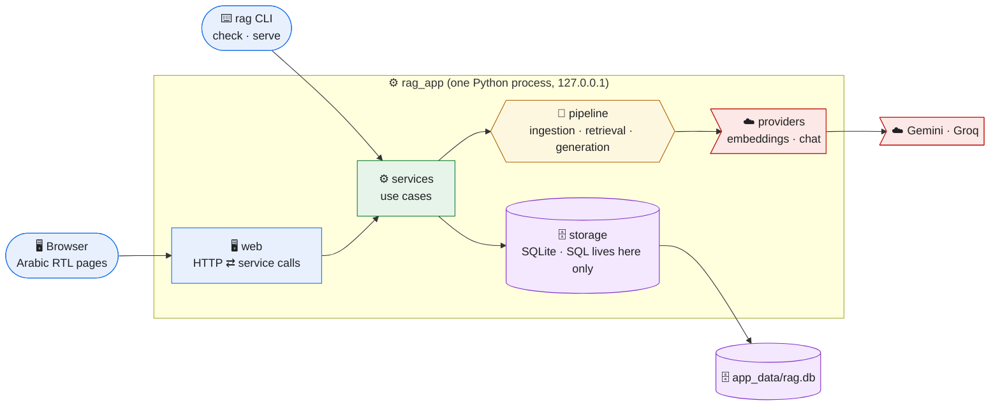
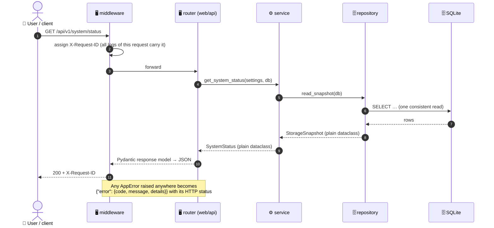

# Developer Guide

| Item | Value |
|---|---|
| Document ID | DEV-001 |
| For | Anyone who will read, change, or maintain this code, now or years from now |
| After reading | You can find any piece of the system, follow a request through it, add a feature in the right place, and know which document to update |
| Status | Phase 5 (foundation). Updated with every phase |
| Rules | Binding standards are in [`05_ENGINEERING_STANDARDS.md`](05_ENGINEERING_STANDARDS.md) (STD-001); this guide explains and points to them |

---

## 1. The System in One Picture



**The one rule behind the picture:** each box talks only to the boxes below it.
- The web layer never runs SQL; it asks a service.
- The pipeline never knows which provider or database is used; it receives interfaces.

This is what lets a failure stay inside one box and lets a box be replaced without touching the others. The rule is **checked automatically** by `uv run lint-imports` (§4).

---

## 2. Project Structure

```text
rag-ai-project/
├── src/rag_app/                    the application (one package)
│   ├── cli.py                      ⌨️ rag check | rag serve
│   ├── web/                        🖥️ interface: HTTP only, no business rules, no SQL
│   │   ├── app.py                     composition root: builds and wires every dependency
│   │   ├── context.py                 AppContext handed to request handlers
│   │   ├── middleware.py              X-Request-ID + request timing log
│   │   ├── errors.py                  every error → one JSON shape
│   │   ├── api/                       JSON API under /api/v1 (schemas.py = response models)
│   │   ├── ui/ · templates/ · static/ Arabic RTL pages (Jinja2, HTMX from Phase 10)
│   ├── services/                   ⚙️ use cases: the only entry point for web and CLI
│   │   ├── system.py                  knowledge-base status
│   │   └── diagnostics.py             checks behind `rag check`
│   ├── ingestion/ retrieval/       🔶 RAG pipeline stages (filled in Phases 6–9)
│   │   generation/ evaluation/
│   │   └── ingestion/poppler.py       finds pdftotext/pdfinfo (D-028)
│   ├── storage/                    🗄️ the only place with SQL
│   │   ├── db.py                      connections, pragmas, transactions
│   │   ├── migrate.py                 applies numbered migrations atomically
│   │   ├── migrations/0001_init.sql   schema, indexes, active_chunk_vectors view
│   │   └── repositories/              queries grouped by aggregate
│   ├── providers/                  ☁️ model providers behind interfaces (Phase 7)
│   ├── config/                     🧩 typed settings and domain profile loaders
│   ├── core/                       🧩 errors (catalog), logging, ids, clock
│   └── domain/                     🧩 shared vocabulary: statuses, formats, outcomes
├── tests/  unit/ integration/      mirrors src/; network blocked by default
├── config/ settings.toml domain_profile.toml
├── docs/                           all project documents (§7)
├── data/sample_corpus/ eval/       Phase 2 corpus and golden set (read-only for tests)
├── poc/ tools/                     Phase 2–4 measurement and documentation tools
├── .github/workflows/ci.yml        CI on Linux and Windows
└── pyproject.toml uv.lock          dependencies (locked) and tool configuration
```

**Where does new code go?** Ask what it *is*:

| It… | Put it in |
|---|---|
| …turns HTTP into a call and back | `web/api/` (JSON) or `web/ui/` (pages) |
| …is a user-level action (upload, ask, delete) | `services/` |
| …transforms data for one RAG step, with no I/O | the pipeline package of that step |
| …reads or writes the database | `storage/repositories/` |
| …talks to a model provider | `providers/` |
| …is a closed set of values used across layers | `domain/models.py` |
| …is a new user-facing error | `core/errors.py` (code + Arabic message + test) |

---

## 3. How a Request Flows



Plain dataclasses cross the layers. Pydantic models exist only at the edges: API responses (`web/api/schemas.py`) and settings (`config/`). Changing the API format therefore never ripples into the pipeline.

---

## 4. Architecture Rules and How They Are Enforced

| Rule | Checked by |
|---|---|
| Layers import downwards only (`web`/`cli` → `services` → pipeline → `storage`/`providers` → `domain`/`config`/`core`) | `lint-imports` (contract 1) |
| Only `web` imports FastAPI, Jinja2, or Starlette | `lint-imports` (contract 2) |
| Only `storage` imports `sqlite3` | `lint-imports` (contract 3) |
| Only `providers` imports `httpx` | `lint-imports` (contract 4) |
| `web` and `cli` never import a repository (the UI is isolated from the database) | `lint-imports` (contract 5) |
| Full type annotations; strict typing | `mypy` |
| UTF-8 file I/O, pathlib, no blind `except`, docstrings | `ruff` |
| Tests never use the network | `pytest-socket` |

CI runs all of these on **Linux and Windows** for every push. A red check blocks merging.

---

## 5. How the API Works

### 5.1 Conventions
| Topic | Convention |
|---|---|
| Base path | `/api/v1`. A breaking change would get `/api/v2`, with v1 kept until clients move |
| Format | JSON in, JSON out, UTF-8. Arabic is returned as-is (not escaped) |
| Errors | Always `{"error": {"code": "FILE_TOO_LARGE", "message": "<Arabic>", "details": {}}}`. The `code` is stable and meant for programs; the `message` is for people |
| Status codes | Taken from the error catalog (`core/errors.py`). Examples: 400 invalid input, 404 not found, 409 conflict, 413 too large, 422 unprocessable file, 429 rate-limited provider, 503 provider unavailable |
| Tracing | Every response has `X-Request-ID`. Send your own (8–64 safe characters) to correlate client and server logs |
| Documentation | Generated from the code: **<http://127.0.0.1:8000/docs>** (interactive) and `/openapi.json`. The contract is designed in DESIGN-001 §11.1 |
| Long work | Uploads return `202 Accepted` and are processed in the background; clients poll the document status (Phase 6) |

### 5.2 Endpoints available now (Phase 5)
| Method | Path | Returns |
|---|---|---|
| GET | `/health` | `{"status": "ok", "version": "0.1.0"}` |
| GET | `/api/v1/system/status` | Document and chunk counts, schema version, index embedding model, whether re-indexing is needed, and provider models (never keys) |

```bash
curl -s http://127.0.0.1:8000/api/v1/system/status
```

```json
{"app_version": "0.1.0", "schema_version": 1, "documents": 0, "versions_by_status": {},
 "active_chunks": 0, "conversations": 0, "index_embedding_model": "",
 "configured_embedding_model": "gemini-embedding-001", "reindex_required": false,
 "providers": [{"role": "embedding", "model": "gemini-embedding-001", "fallback_model": null},
               {"role": "chat", "model": "qwen/qwen3.8-27b", "fallback_model": "openai/gpt-oss-20b"}]}
```

The document, version, and conversation endpoints of DESIGN-001 §11.1 are added in Phases 6–9.

### 5.3 Adding an endpoint (recipe)
1. Write or extend a **service** function that takes and returns plain types or dataclasses.
2. Add a **response model** in `web/api/schemas.py`.
3. Add the **route** in `web/api/<area>.py`. It gets dependencies through `Depends(get_context)`, calls the service, and returns the model.
4. Raise `AppError(ErrorCode.X, …)` for expected failures; never build error responses by hand.
5. Add tests: a service unit test, plus an API integration test that also checks the error case.
6. Update DESIGN-001 §11.1 if the contract changed, and add the endpoint to §5.2 above.

---

## 6. Database and Performance

| Topic | What we do | Why |
|---|---|---|
| Engine | SQLite, one file in `app_data/`, **WAL** mode | Readers never block the background worker; single-user scale (T-05) |
| Integrity | `foreign_keys=ON`, `ON DELETE CASCADE` from versions to chunks, vectors, and jobs; `CHECK` constraints on statuses and vector length | Deleting cannot leave orphans; impossible states are rejected by the database itself |
| Transactions | `db.transaction()` = `BEGIN IMMEDIATE … COMMIT`, rolled back on any error | Multi-row changes are all-or-nothing (DESIGN-001 §7.1) |
| Indexes | One per hot query: duplicate check (`content_hash`), version history, job queue (`status, created_at`), messages in order, conversation list, citations by message and by chunk | Each lookup is O(log n) instead of a table scan |
| Retrieval set | View `active_chunk_vectors`: only **ready, active** versions | Retrieval can never see an inactive or half-processed version |
| Proof | `tests/integration/storage/test_migrations.py` checks `EXPLAIN QUERY PLAN` for every hot query | A future change that drops an index fails CI |
| Similarity search | Exact cosine in NumPy over the active vectors, cached in memory (Phase 7–8) | Measured 0.6–2.3 ms at 20,000 chunks (TECH-001 T-05); far under the 1 s target |

**Schema changes:** add `storage/migrations/000N_<what>.sql`. Never edit an applied migration. The app applies pending migrations at start-up, each in its own transaction.

---

## 7. Where Every Document Lives

| Document | Answers the question | Update it when |
|---|---|---|
| [`README.md`](../README.md) | How do I install, configure, and run it? What data leaves my computer? | Any user-visible change |
| [`CLAUDE.md`](../CLAUDE.md) | How must the engineer work on this project? (Arabic, reference) | Owner decision only |
| [`docs/PROJECT_BRIEF.md`](PROJECT_BRIEF.md) | What is the project and its scope? (Arabic, reference) | Owner decision only |
| [`docs/EXECUTION_PROTOCOL.md`](EXECUTION_PROTOCOL.md) | How are phases planned, approved, and changed? (Arabic, reference) | Owner decision only |
| [`docs/planning/PHASE_0_DISCOVERY_AND_PLAN.md`](planning/PHASE_0_DISCOVERY_AND_PLAN.md) | What is the phase plan and why? | Plan changes |
| [`docs/01_SRS.md`](01_SRS.md) | **What** must the system do? (requirement IDs) | Through change management |
| [`docs/02_SAMPLE_CORPUS.md`](02_SAMPLE_CORPUS.md) | What test data exists and how was it verified? | Corpus or golden-set changes |
| [`docs/03_TECHNOLOGY_EVALUATION.md`](03_TECHNOLOGY_EVALUATION.md) | **Why** these technologies? (measurements, sources) | A technology is reconsidered |
| [`docs/04_ARCHITECTURE_AND_DESIGN.md`](04_ARCHITECTURE_AND_DESIGN.md) | **How** is it built? (architecture, data, pipelines, API) | Any structural change, in the same PR |
| [`docs/05_ENGINEERING_STANDARDS.md`](05_ENGINEERING_STANDARDS.md) | What rules must code and docs follow? | A rule changes (owner approval) |
| `docs/06_DEVELOPER_GUIDE.md` (this file) | Where is everything and how do I work with it? | Structure, endpoints, or workflow change |
| [`docs/DECISIONS.md`](DECISIONS.md) | What was decided, when, and why? | Every approved decision |
| [`CHANGELOG.md`](../CHANGELOG.md) | What changed in each release? | Each phase PR |
| Docstrings in `src/` | What does this function or module do and why? | With the code |

---

## 8. Writing Documentation: the Eight Rules

From STD-001 §14.2, with an example of each:

| # | Rule | Instead of… | Write… |
|---|---|---|---|
| 1 | **Write for a named reader** | (no audience) | "For whoever maintains the ingestion worker" |
| 2 | **Most useful first** | three paragraphs of background, then the command | the command, then the background |
| 3 | **Show, don't tell** | "configure the provider appropriately" | the exact TOML block |
| 4 | **Short, active sentences; consistent terms** | "Chunks may be created by the system when…" | "The chunker splits each section into chunks." |
| 5 | **Link, don't duplicate** | copying the deletion rules | "Deletion follows DESIGN-001 §7.2" |
| 6 | **Evidence over adjectives** | "very fast search" | "0.6 ms at 20,000 chunks (T-05)" |
| 7 | **Keep it current** | docs updated "later" | the doc change in the same commit as the code |
| 8 | **Language** | mixed languages | English for code and docs; Arabic for UI text and owner reports |

## 9. Drawing Diagrams: the Rules

1. **Mermaid only.** Diagrams are text, live next to the prose, and render on GitHub.
2. **One visual language:**

| Shape and colour | Meaning |
|---|---|
| 👤🖥️ blue, rounded | people and interface |
| ⚙️ green, rectangle | our services |
| 🔶 amber, hexagon | a RAG pipeline stage |
| 🗄️ purple, cylinder | stored data |
| ☁️ red, flag shape | external provider |
| 🔧 grey, double-edged box | local tool |

3. **One message per diagram.** If arrows cross, split the diagram.
4. **Validate before committing:** `cd tools/docs && node check_mermaid.mjs ../../docs/*.md ../../README.md`. This renders every diagram with Mermaid 11 and 12; CI runs it too.

---

## 10. Everyday Commands

| Task | Command |
|---|---|
| Install or update the environment | `uv sync` |
| Run the app | `uv run rag serve` → <http://127.0.0.1:8000> |
| Check the environment | `uv run rag check` |
| All tests | `uv run pytest` |
| One test file, verbose | `uv run pytest tests/integration/storage/test_migrations.py -v` |
| Coverage report | `uv run pytest --cov` |
| Lint, format, types, layers | `uv run ruff check` · `uv run ruff format` · `uv run mypy` · `uv run lint-imports` |
| Add a runtime or dev dependency | `uv add <pkg>` or `uv add --dev <pkg>`, then explain why in the commit (STD-001 §2.2) |
| Before every commit | the review checklist, STD-001 §13 |
